# State Management in React


 **React State Management** reference repository! This repository contains structured study notes, visual diagrams, and clean implementations designed for deep conceptual mastery and practical problem solving across modern React state management solutions, categorized into:
- **Client State**: Managing local synchronous application UI data (**Zustand**, **Valtio**, **Jotai**, **Redux Toolkit**, **Entity Adapter**).
- **Server State**: Managing asynchronous remote data fetching, caching, and synchronization (**TanStack React Query**, **RTK Query**).

> **Author:** Kamal Aboueid  
> **Topics:** State Management in React  
> **Client State:** Zustand • Valtio • Jotai • Redux Toolkit  
> **Server State:** TanStack React Query • RTK Query  
> **Status:** Active Learning & Hands-on Reference

---

# Zustand

Zustand is a fast, lightweight state management library for React. It provides a centralized store with a minimal API, zero boilerplate, and no need to wrap your app in Context Providers.

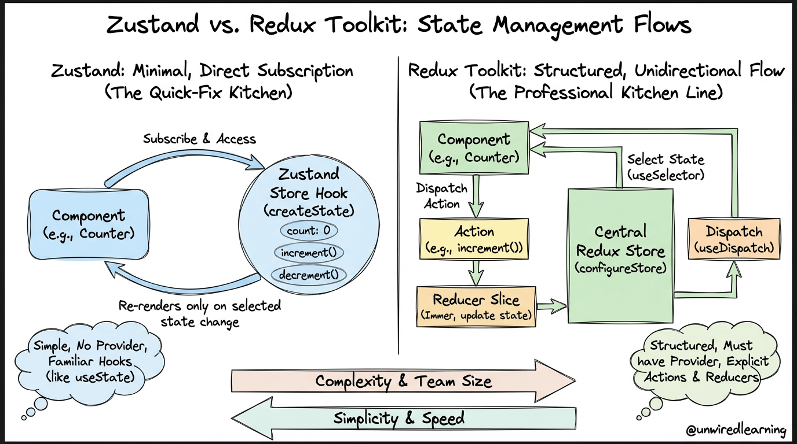
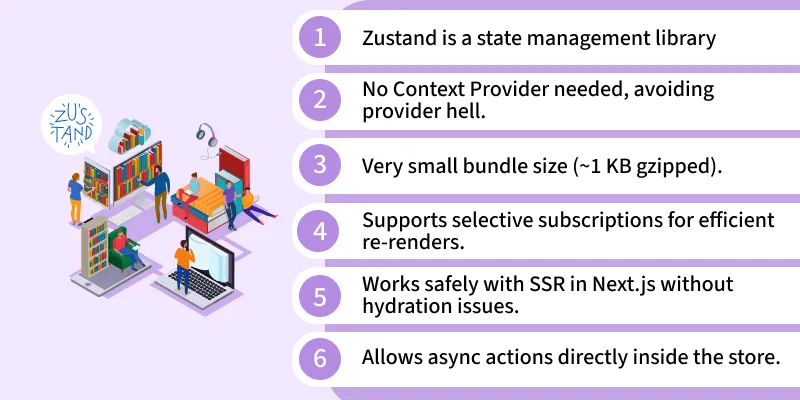
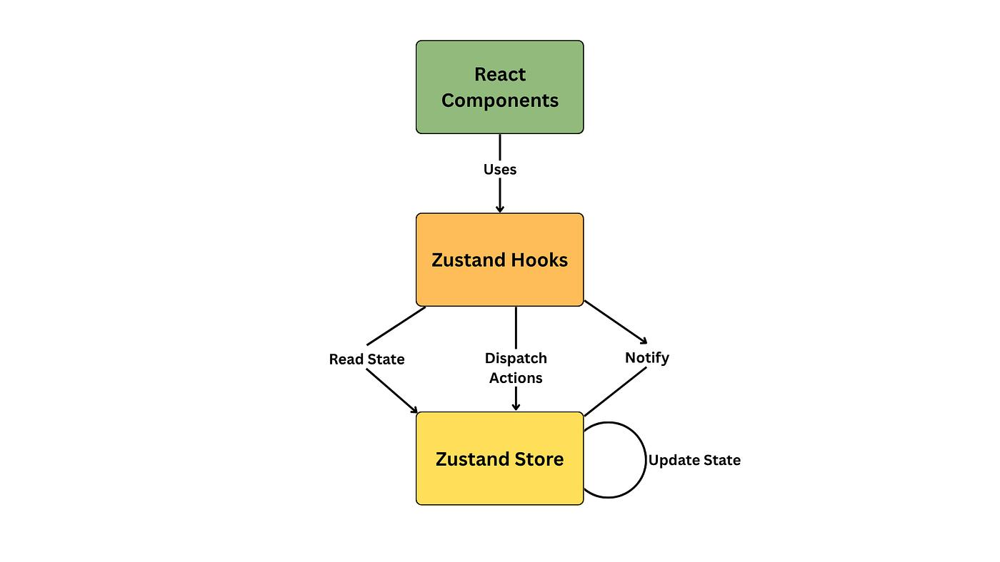
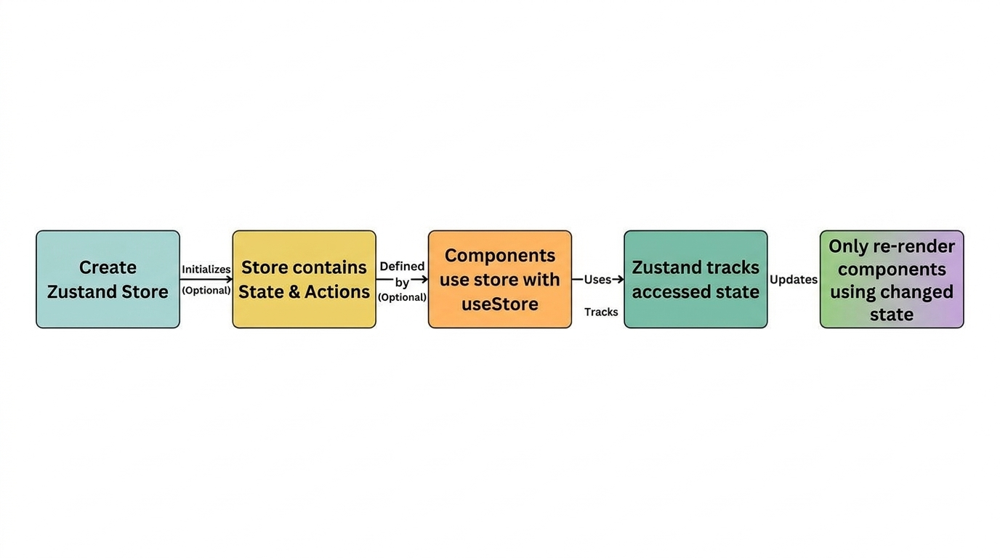

## Creating a Store & Updating State
Use `create` to define state values and action methods. Zustand provides `set` for state updates (merging shallowly by default, so you don't need to spread unmodified state).

```js
import { create } from "zustand";

const useStore = create((set) => ({
  count: 0,
  increment: () => set((state) => ({ count: state.count + 1 })),
  decrement: () => set((state) => ({ count: state.count - 1 })),
}));

export default useStore;
```

## Immer Middleware
Immer allows direct mutable updates (mutating drafts) while maintaining full immutability under the hood.

```js
import { create } from "zustand";
import { immer } from "zustand/middleware/immer";

export const useArray = create(
  immer((set) => ({
    todos: [],
    addTodo: (newTodo) =>
      set((state) => {
        state.todos.push(newTodo);
      }),
  }))
);
```

## Store Slice Pattern & Combining Slices
For larger applications, split stores into smaller feature slices and combine them into one bound store:

```js
// authSlice.js
export const createAuthSlice = (set) => ({
  user: null,
  login: (user) => set({ user }),
  logout: () => set({ user: null }),
});

// cartSlice.js
export const createCartSlice = (set) => ({
  cart: [],
  addToCart: (item) => set((state) => ({ cart: [...state.cart, item] })),
  removeFromCart: (item) => set((state) => ({ cart: state.cart.filter((i) => i !== item) })),
});

// store.js
import { create } from "zustand";
import { createAuthSlice } from "./authSlice";
import { createCartSlice } from "./cartSlice";

export const useBoundStore = create((...a) => ({
  ...createAuthSlice(...a),
  ...createCartSlice(...a),
}));
```

## Accessing Store Values & `useShallow`
Select only the values needed to avoid unnecessary re-renders. Use `useShallow` when selecting an object or array of multiple values.

```jsx
import { useBoundStore } from "./store";
import { useShallow } from "zustand/react/shallow";

function Header() {
  const { user, logout } = useBoundStore(
    useShallow((state) => ({
      user: state.user,
      logout: state.logout,
    }))
  );

  return (
    <header>
      {user ? <button onClick={logout}>Logout</button> : <span>Not logged in</span>}
    </header>
  );
}
```

## Persist Middleware
Saves store data in browser storage (`localStorage` by default) with support for partialize and versioning:

```js
import { create } from "zustand";
import { persist } from "zustand/middleware";

export const useAuthStore = create(
  persist(
    (set) => ({
      user: null,
      token: null,
      setAuth: (user, token) => set({ user, token }),
      logout: () => set({ user: null, token: null }),
    }),
    {
      name: "auth-storage",
      partialize: (state) => ({ user: state.user }),
      version: 1,
    }
  )
);
```

## `subscribeWithSelector` & Redux DevTools
- `subscribeWithSelector`: Listen to specific state changes outside React components (ideal for logging, analytics, sync).
- `devtools`: Enables inspection and time-travel debugging inside Redux DevTools.

```js
import { create } from "zustand";
import { devtools, persist, subscribeWithSelector } from "zustand/middleware";

export const useStore = create(
  devtools(
    persist(
      subscribeWithSelector((set) => ({
        count: 0,
        increment: () =>
          set((state) => ({ count: state.count + 1 }), false, "counter/increment"),
      })),
      { name: "counter-storage" }
    ),
    { name: "Counter Store" }
  )
);

// Subscribe to a specific field
useStore.subscribe(
  (state) => state.count,
  (current, prev) => console.log(`Count changed from ${prev} to ${current}`)
);
```

---

# Valtio (Proxy-Based State Management)

Valtio makes state management in React feel like plain JavaScript. It wraps your state in a native JavaScript `Proxy`, allowing you to mutate values directly (e.g. `state.count++`, `state.todos.push()`), while providing React with immutable frozen snapshots via `useSnapshot` to ensure optimal, property-level re-rendering.

> **Official References:**
> - Official Documentation: [valtio.pmnd.rs](https://valtio.pmnd.rs/)
> - GitHub Repository: [pmndrs/valtio](https://github.com/pmndrs/valtio)

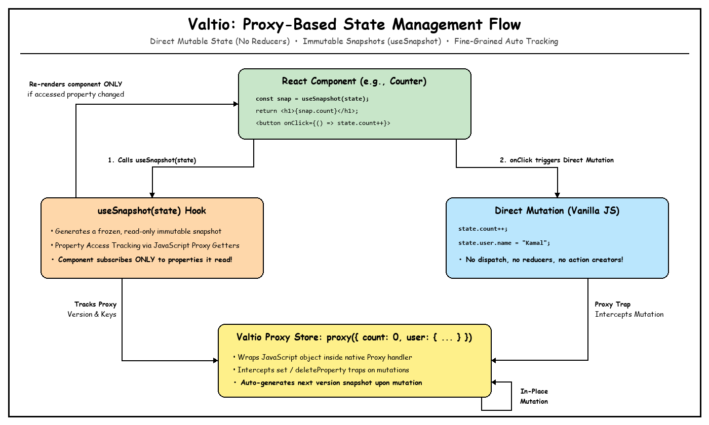
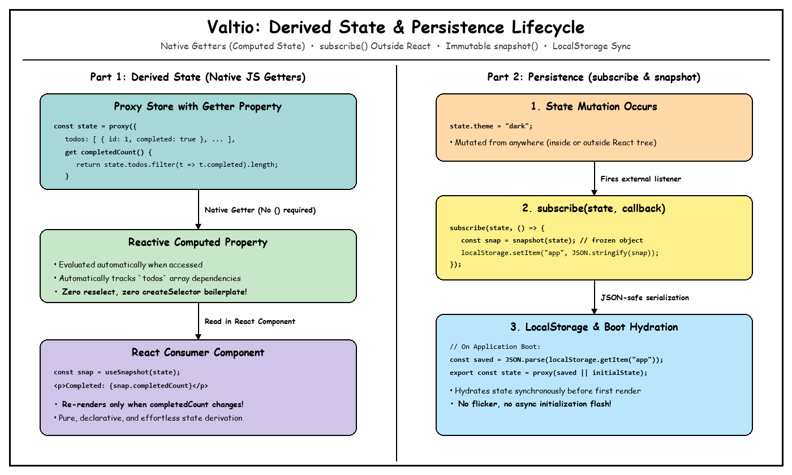

## 1. Core Mental Model: Proxy & Direct Mutability
Traditional React state libraries require immutability ceremony: spreading objects (`...state`), action creators, and reducers. Valtio uses native ES6 `Proxy` to intercept property access and mutations under the hood:

- **Direct In-Place Mutation**: Mutate objects and arrays directly as in vanilla JS (`state.count++`, `state.user.name = "Kamal"`, `state.todos.push(item)`).
- **No Reducers or Setters**: Write business logic in normal functions or directly in callbacks.
- **Native JavaScript Feel**: Works with nested objects, arrays, Maps, and Sets without special update helpers or Immer wrappers.

### Creating a Store ([`valito.js`](file:///d:/directState/src/pages/Valito/valito.js))

```javascript
import { proxy } from "valtio";

export const state = proxy({
  count: 0,
  user: {
    name: "Kamal Abou Eid",
    isLoggedIn: true,
  },
});
```

---

## 2. `useSnapshot` & Automatic Render Optimization

The cornerstone of Valtio in React is the `useSnapshot` hook.

```jsx
import { useSnapshot } from "valtio";
import { state } from "./valito";

export default function Counter() {
  // 1. READ ONLY from snap inside component render
  const snap = useSnapshot(state);

  return (
    <div>
      <h1>Count: {snap.count}</h1>
      <p>User: {snap.user.name}</p>

      {/* 2. WRITE ONLY to the original mutable proxy state */}
      <button onClick={() => state.count++}>Increment</button>
      <button onClick={() => { state.user.name = "Ali"; }}>Change Name</button>
    </div>
  );
}
```

### The Golden Rule of Valtio:
> [!IMPORTANT]
> **READ from `snap` in component render; WRITE to `state` in event handlers and callbacks.**
> - `snap` is a deeply frozen, read-only JavaScript object (`Object.freeze`). Attempting to mutate `snap.count++` throws an error in strict mode.
> - `state` is the mutable proxy. Always perform mutations directly on `state`.

### Why do we use `useSnapshot`?
1. **Fine-Grained Property Tracking**: When a component reads `snap.count`, Valtio marks that this component depends *only* on the `count` property. If another component mutates `state.user.name`, this component **will not re-render**!
2. **Structural Sharing & Memoization**: Valtio creates a new snapshot only for properties that were actually mutated, reusing unchanged object references.
3. **No Selectors Required**: You don't need `useStore(state => state.count)` or equality checks (`shallow`) like in Zustand or Redux. Property access in JSX is the selector!

---

## 3. Organizing State Updates with Actions Pattern

In larger applications, scattering direct mutations throughout JSX can make debugging harder. Valtio lets you group mutations into an `appActions` object or methods:

### Implementation ([`vakitoWithActions.js`](file:///d:/directState/src/pages/Valito/vakitoWithActions.js))

```javascript
import { proxy } from "valtio";

export const appState = proxy({
  theme: "light",
  newTodoText: "",
  todos: [
    { id: 1, text: "Learning Valtio Fundamentals", completed: true },
    { id: 2, text: "Building Todo App with Client State", completed: false },
  ],
});

export const appActions = {
  toggleTheme: () => {
    appState.theme = appState.theme === "light" ? "dark" : "light";
  },
  setNewTodoText: (text) => {
    appState.newTodoText = text;
  },
  addTodo: (text) => {
    const value = (text !== undefined ? text : appState.newTodoText).trim();
    if (!value) return;
    appState.todos.push({
      id: Date.now(),
      text: value,
      completed: false,
    });
    appState.newTodoText = "";
  },
  toggleTodo: (id) => {
    const todo = appState.todos.find((item) => item.id === id);
    if (todo) {
      todo.completed = !todo.completed;
    }
  },
  deleteTodo: (id) => {
    const index = appState.todos.findIndex((item) => item.id === id);
    if (index !== -1) {
      appState.todos.splice(index, 1);
    }
  },
};
```

### React Todo Component ([`ToDoList.jsx`](file:///d:/directState/src/pages/Valito/ToDoList.jsx))

```jsx
import React from "react";
import { useSnapshot } from "valtio";
import { appState, appActions } from "./vakitoWithActions";

export default function TodoList() {
  const snap = useSnapshot(appState);

  return (
    <div>
      <input
        type="text"
        value={snap.newTodoText}
        onChange={(e) => appActions.setNewTodoText(e.target.value)}
        placeholder="New task..."
      />
      <button onClick={() => appActions.addTodo()}>Add</button>

      <ul>
        {snap.todos.map((todo) => (
          <li
            key={todo.id}
            onClick={() => appActions.toggleTodo(todo.id)}
            style={{ textDecoration: todo.completed ? "line-through" : "none" }}
          >
            {todo.text}
          </li>
        ))}
      </ul>
    </div>
  );
}
```

---

## 4. Derived & Computed State (Native Getters)

Valtio handles computed/derived values using native JavaScript `get` object getters. You don't need `createSelector`, `useMemo`, or external memoization libraries.

### Defining Derived Getters ([`DrivedState.js`](file:///d:/directState/src/pages/Valito/DrivedState.js))

```javascript
import { proxy } from "valtio";

export const state = proxy({
  todos: [
    { id: 1, text: "Learn Valtio Proxy Architecture", completed: true },
    { id: 2, text: "Implement Derived State with Native Getters", completed: true },
    { id: 3, text: "Build React Reactive UI with useSnapshot", completed: false },
  ],

  // Native JavaScript getter: evaluated as a property (without ())
  get completedCount() {
    return state.todos.filter((todo) => todo.completed).length;
  },

  get remainingCount() {
    return state.todos.length - state.completedCount;
  },

  get progressPercentage() {
    if (state.todos.length === 0) return 0;
    return Math.round((state.completedCount / state.todos.length) * 100);
  },
});
```

### Consuming Derived State in React ([`Drived.jsx`](file:///d:/directState/src/pages/Valito/Drived.jsx))

```jsx
import React from "react";
import { useSnapshot } from "valtio";
import { state } from "./DrivedState";

export default function TodoStats() {
  const snap = useSnapshot(state);

  return (
    <div>
      <p>Progress: {snap.progressPercentage}%</p>
      <p>Completed Tasks: {snap.completedCount}</p>
      <p>Remaining Tasks: {snap.remainingCount}</p>
    </div>
  );
}
```

---

## 5. State Persistence (`subscribe` + `snapshot`)

Unlike React state which lives strictly inside the component tree, Valtio stores exist independently in module scope. You can listen to mutations outside React and sync to `localStorage` effortlessly using `subscribe` and `snapshot`.

### Implementation ([`valitoWithPresistance.js`](file:///d:/directState/src/pages/Valito/valitoWithPresistance.js))

```javascript
import { proxy, subscribe, snapshot } from "valtio";

const STORAGE_KEY = "valtio_persisted_state";

// 1. Synchronous Hydration from LocalStorage on Startup
const loadInitialState = () => {
  try {
    const raw = localStorage.getItem(STORAGE_KEY);
    if (raw) return JSON.parse(raw);
  } catch (err) {
    console.warn("Could not read Valtio state from storage:", err);
  }
  return {
    theme: "dark",
    counter: 10,
    lastSavedAt: null,
  };
};

export const persistenceState = proxy(loadInitialState());

// 2. subscribe() runs on every mutation outside the React component lifecycle
subscribe(persistenceState, () => {
  // snapshot() creates a frozen, plain JS object safe for JSON.stringify
  const snap = snapshot(persistenceState);
  try {
    localStorage.setItem(STORAGE_KEY, JSON.stringify(snap));
  } catch (err) {
    console.error("Could not persist Valtio state:", err);
  }
});
```

### Theme & Persistence Component ([`ThemeToggle.jsx`](file:///d:/directState/src/pages/Valito/ThemeToggle.jsx))

```jsx
import React from "react";
import { useSnapshot } from "valtio";
import { persistenceState } from "./valitoWithPresistance";

export default function ThemeToggle() {
  const snap = useSnapshot(persistenceState);

  return (
    <div style={{ background: snap.theme === "dark" ? "#111" : "#fff", color: snap.theme === "dark" ? "#fff" : "#111" }}>
      <p>Active Theme: {snap.theme}</p>
      <p>Persisted Counter: {snap.counter}</p>

      <button onClick={() => { persistenceState.theme = persistenceState.theme === "dark" ? "light" : "dark"; }}>
        Toggle Theme
      </button>
      <button onClick={() => { persistenceState.counter++; }}>
        Increment Counter
      </button>
    </div>
  );
}
```

---

# Deep Architectural Comparison: Zustand vs. Valtio

Both **Zustand** and **Valtio** were created under the [Poimandres](https://github.com/pmndrs) developer collective to eliminate the boilerplate, ceremony, and complexity of legacy Redux. They provide zero-provider setups, direct subscriptions, and minimal bundle sizes. However, they approach state architecture from fundamentally opposite paradigms:

- **Zustand**: Modern, centralized **Flux-like store hook** with functional immutable setters and explicit selectors.
- **Valtio**: Transparent, **Proxy-based reactive state** with direct mutable JavaScript operations and automated fine-grained snapshots.

---

## 1. Core Architectural Pillars

### Pillar 1: Paradigm & Mental Model
- **Zustand (Flux-like Centralized Hook)**:  
  State is stored in a single bound store hook (`useStore`). State transitions happen through explicit updater functions (`set`), following the familiar React `useState` mindset. You always think in terms of immutable state transitions.
- **Valtio (Transparent ES6 Proxy)**:  
  State is a vanilla JavaScript object wrapped inside a native `Proxy`. You read and write to state as if it were a plain mutable object (`state.count++`, `state.todos.push(newTodo)`). You think in plain JavaScript rather than React-specific state immutability.

### Pillar 2: Mutation & Update Mechanism
- **Zustand (Immutable Updates via `set`)**:  
  State updates merge top-level keys shallowly by default (`set((state) => ({ count: state.count + 1 }))`). Modifying nested properties requires manual object spreading (`...state.user, address: { ... }`) or wrapping the store in the `immer` middleware.
- **Valtio (Direct In-Place Mutation)**:  
  You mutate arbitrarily deep properties directly in place: `state.user.address.city = 'Cairo'`. The Proxy interceptor catches mutation traps (`set`, `deleteProperty`), automatically creates a new immutable structural snapshot (`Object.freeze`), and notifies React.

### Pillar 3: Performance & Re-Render Optimization
- **Zustand (Explicit Manual Selectors)**:  
  Components must define explicit selector functions: `const count = useStore((state) => state.count)`. If you select multiple fields into an object without `useShallow`, the component will re-render whenever *any* store property changes.
- **Valtio (Automatic Fine-Grained Property Tracking)**:  
  Components consume the state via `const snap = useSnapshot(state)`. As the component renders, Valtio tracks *which specific properties* are accessed (`snap.count`). If other properties change (`state.user`), this component is automatically skipped without writing selectors or memoization checks.

---

## 2. Side-by-Side Implementation Comparison

### Example: Counter & User Profile State

#### Zustand Implementation
```javascript
import { create } from "zustand";

export const useStore = create((set) => ({
  count: 0,
  user: { name: "Kamal", role: "Frontend Lead" },
  
  // Actions defined within store
  increment: () => set((state) => ({ count: state.count + 1 })),
  decrement: () => set((state) => ({ count: state.count - 1 })),
  setName: (name) =>
    set((state) => ({
      user: { ...state.user, name }, // manual spread for nested updates
    })),
}));

// In Component: Explicit selector required
function UserCard() {
  const name = useStore((state) => state.user.name);
  const setName = useStore((state) => state.setName);
  return <button onClick={() => setName("Ali")}>{name}</button>;
}
```

#### Valtio Implementation
```javascript
import { proxy, useSnapshot } from "valtio";

export const state = proxy({
  count: 0,
  user: { name: "Kamal", role: "Frontend Lead" },
});

// Optional actions object or direct mutations
export const actions = {
  increment: () => state.count++,
  decrement: () => state.count--,
  setName: (name) => {
    state.user.name = name; // direct in-place nested mutation
  },
};

// In Component: Automatic property tracking
function UserCard() {
  const snap = useSnapshot(state);
  return <button onClick={() => actions.setName("Ali")}>{snap.user.name}</button>;
}
```

---

## 3. Comprehensive Pros & Cons Comparison

| Feature / Category | Zustand | Valtio |
| :--- | :--- | :--- |
| **Primary Strength** | Predictable, functional, lightweight Flux architecture with strict state transitions | Effortless mutable programming model with zero selectors and automatic render tracking |
| **Bundle Size** | **~1.1 kB** (featherweight) | **~3.1 kB** (includes full Proxy and snapshot tracking engine) |
| **Nested State** | Requires manual object spreading or `immer` middleware | **Native out-of-the-box**: mutate nested arrays/objects directly |
| **Render Optimization** | Manual: requires selector hooks `(s => s.prop)` or `useShallow` | **Automatic**: `useSnapshot` tracks accessed keys at the getter level |
| **Computed / Derived State** | Computed in selectors or manual store getters | **Native JS Getters** (`get total()`) directly in proxy |
| **Access Outside React** | `useStore.getState()`, `useStore.setState()`, `useStore.subscribe()` | Direct access: `state.x = 10`, `subscribe(state, callback)` |
| **Debugging & DevTools** | Excellent Redux DevTools integration with named action labels | Supported via `devtools(state)`, but logs can be noisy due to fine-grained proxy sets |
| **Main Drawback** | Boilerplate can grow with complex nested state; forgetting selectors causes re-renders | Developers must strictly respect the Golden Rule (read from `snap`, write to `state`) |

---

## 4. Practical Decision Matrix: When to Choose Which?

### Choose **Zustand** when:
1. **You want strict, predictable unidirectional data flow**: Your team is accustomed to Redux or React's standard immutable functional style (`set((s) => ({ ... }))`).
2. **Bundle size is critical**: At ~1.1 kB, Zustand has nearly zero footprint and adds minimal overhead to landing pages or lightweight applications.
3. **Your state is predominantly flat**: Authentication tokens, theme toggles, modal dialog states, and standard dashboard settings.
4. **You need strict action auditing**: You rely on detailed time-travel debugging with explicit action type names in Redux DevTools.

### Choose **Valtio** when:
1. **You have deeply nested or complex state structures**: Nested arrays, form wizards, complex user settings, or relational in-memory data that would otherwise require multiple layers of object spreading.
2. **You want zero selector boilerplate**: You prefer writing `snap.user.profile.avatar` without having to craft selectors, equality functions, or `useShallow` guards.
3. **You are building canvas, 3D, or game loop apps (Three.js / React Three Fiber)**: Valtio is the gold standard for imperative graphics engines where objects mutate 60 times per second outside React, while UI overlays seamlessly react via snapshots.
4. **You want rapid prototyping**: State feels like vanilla JavaScript, making development fast and intuitive without React-specific ceremonies.

---

---

# Atomic State Management: React State with Jotai

If you have used React, you probably know how difficult it can be to manage global state. In the past, we had to use big tools like Redux, which needed a lot of extra code like actions and reducers. Later, tools like Zustand and Valtio made things much easier.

Jotai introduces a simple, modern way to manage global state using the **atomic model**.

> **Official References:**
> - Official Documentation: [jotai.org](https://jotai.org/)
> - GitHub Repository: [pmndrs/jotai](https://github.com/pmndrs/jotai)
> - Basics & Primitives Guide: [jotai.org/docs/basics/primitives](https://jotai.org/docs/basics/primitives)

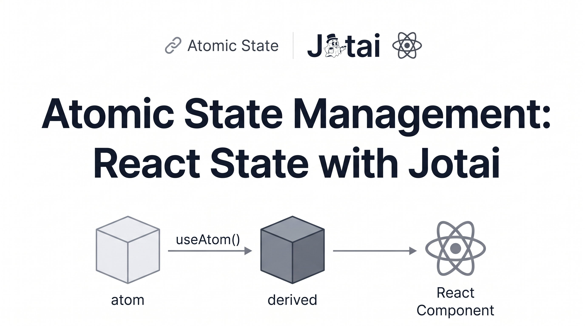
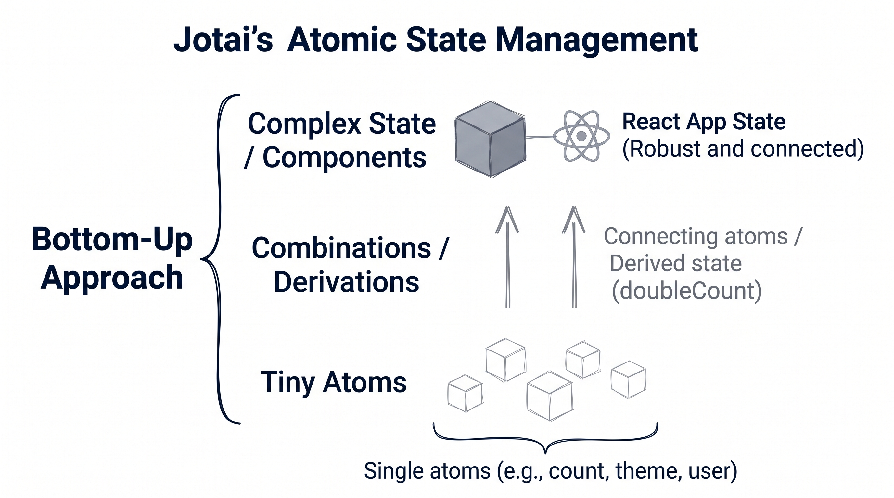

## 1. What is Jotai?

**Jotai** is a small and modern state management library for React. The word "Jotai" means "state" in Japanese.

Its core philosophy is **atomic state**. Instead of putting all your application data into one large centralized object (top-down), you decompose your state into small, independent pieces called **atoms** (bottom-up).

An **atom** holds a small piece of data: a number, a string, a boolean, an array, or an object. When you need complex state, you combine these small atoms together through derived computations.

---

## 2. Why Choose Jotai?

- **No Extra Code (Zero Boilerplate)**: You do not need actions, reducers, dispatchers, or provider wrappers. You just create an atom and use it directly.
- **Familiar Syntax**: If you know how to use React's `useState`, you already know Jotai. `useAtom(myAtom)` returns `[value, setValue]` identical to `useState`.
- **Fast Performance (Automatic Render Isolation)**: A component only re-renders when the specific atom it subscribes to changes. If an unrelated atom changes, other components completely ignore it.
- **Tiny Bundle Footprint**: Jotai is featherweight (~2.4KB minified and gzipped), keeping your app fast and light.

---

## 3. How to Use Jotai

### Step 1: Installation
```bash
npm install jotai
```

### Step 2: Defining Atoms ([`jotai.js`](file:///d:/directState/src/pages/Jotai/jotai.js))

Create a file to hold your atoms. Import the `atom` function from `jotai` and define your state:

```javascript
import { atom } from "jotai";

// 1. Primitive atom starting at 0
export const countAtom = atom(0);

// 2. Derived (read-only) atom that calculates double the count
export const doubleCountAtom = atom((get) => get(countAtom) * 2);

// 3. Independent text atom
export const textAtom = atom("Jotai Atomic State");
```

**How does `get` work?**  
In `doubleCountAtom`, we pass a function with the `get` parameter. This built-in helper reads the current value of `countAtom` and tracks it as a dependency. Whenever `countAtom` changes, `doubleCountAtom` updates automatically without manual dependency arrays.

### Step 3: Using Atoms in Components ([`CounterWithJotai.jsx`](file:///d:/directState/src/pages/Jotai/CounterWithJotai.jsx))

Import `useAtom` or `useAtomValue` inside your React components to read and update the state:

```jsx
import React from "react";
import { useAtom, useAtomValue } from "jotai";
import { countAtom, doubleCountAtom } from "./jotai";

export function Counter() {
  const [count, setCount] = useAtom(countAtom);
  const doubleCount = useAtomValue(doubleCountAtom);

  return (
    <div>
      <h2>Count: {count}</h2>
      <h3>Double Count: {doubleCount}</h3>

      <button onClick={() => setCount((c) => c + 1)}>
        Increment (+)
      </button>
      <button onClick={() => setCount((c) => c - 1)}>
        Decrement (-)
      </button>
    </div>
  );
}
```

---

## 4. Jotai vs. Other State Managers

| Feature | Redux Toolkit | Zustand | Valtio | Jotai |
| :--- | :--- | :--- | :--- | :--- |
| **Architecture** | Top-down single store tree | Top-down centralized store hook | Proxy-wrapped mutable object | **Bottom-up atomic graph** |
| **Update Model** | Unidirectional: Actions + Reducers | Immutable via `set` | In-place Proxy mutations | Immutable setter `setCount(c => c + 1)` |
| **Selectors** | Required (`useSelector`) | Recommended (`useStore(s => s.x)`) | Not needed (Proxy getter tracking) | **Not needed (Atom granularity)** |
| **Render Isolation**| Manual via selectors | Manual via selectors or `useShallow` | Automatic via `useSnapshot` | **Automatic per atom** |
| **Bundle Size** | ~11 kB | ~1.1 kB | ~3.1 kB | **~2.4 kB** |
| **Mental Model** | Enterprise Flux with rigid actions | Familiar hook store | Vanilla JS mutable object | **React `useState` taken to global scope** |

- **Redux** puts all state in one giant store. It is great for enterprise apps with strict auditing, but changing a simple value takes multiple files and boilerplate.
- **Zustand** provides a single centralized store with hooks. However, you must write manual selectors to avoid unnecessary re-renders.
- **Valtio** uses JavaScript Proxies to allow direct in-place mutations (`state.count++`) and generates immutable snapshots for React.
- **Jotai** takes a bottom-up path. Because each piece of state is already a separate atom, you do not need manual selectors. You just import the exact atom you need, and React only updates the components that consume that atom.

---

## 5. Conclusion & Practical Takeaway

Jotai proves that global state management in React does not have to be complicated. By breaking application data down into independent atoms, you achieve:
- **Ultra-simple code** with zero boilerplate.
- **Automatic render isolation** without selectors or memoization wrappers.
- **A developer experience** that feels just like standard native React.

---

# Redux Toolkit (RTK) Notes

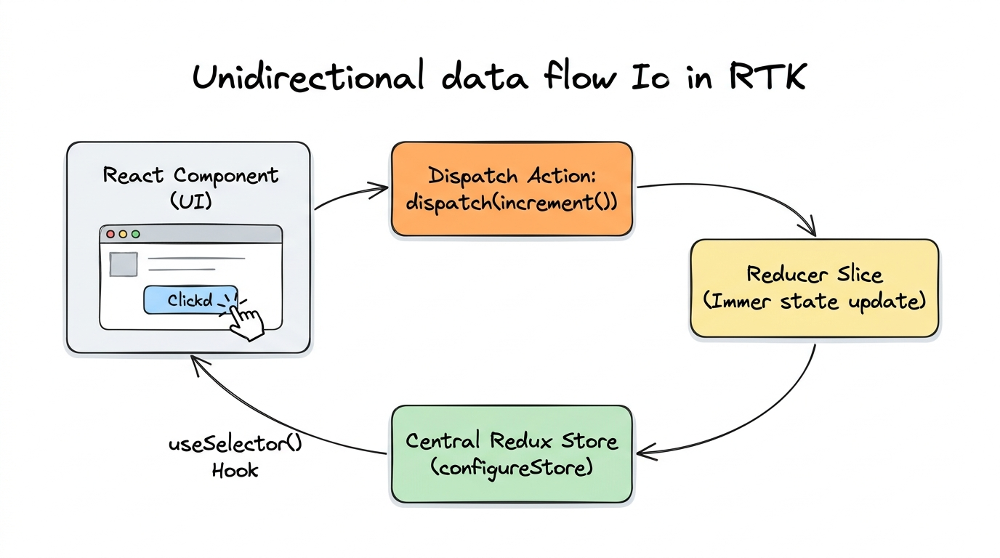

## 1. Redux Fundamentals
Redux manages shared global state through a predictable unidirectional flow:
**UI** → `dispatch(action)` → **Reducer** → **State Update** → **UI Re-render**

- **State:** The data stored in Redux (e.g., `{ count: 0, user: null }`).
- **Action:** An object describing what happened (`{ type: "counter/add", payload: 5 }`).
- **Reducer:** Pure function determining how state updates in response to actions.
- **Dispatch:** Triggers actions into the Redux store (`dispatch(increment())`).

## 2. Installation & Store Setup
```bash
npm install @reduxjs/toolkit react-redux
```

```jsx
// store.js
import { configureStore } from "@reduxjs/toolkit";
export const store = configureStore({ reducer: {} });

// main.jsx
import { Provider } from "react-redux";
import { store } from "./store";

<Provider store={store}>
  <App />
</Provider>
```

## 3. `createSlice`
Combines initial state, reducers, and auto-generated action creators in one place. RTK uses **Immer** internally, allowing you to write mutating syntax (`state.count += 1`) safely.

```js
// counterSlice.js
import { createSlice } from "@reduxjs/toolkit";

const counterSlice = createSlice({
  name: "counter",
  initialState: { count: 0 },
  reducers: {
    increment: (state) => { state.count += 1; },
    decrement: (state) => { state.count -= 1; },
  },
});

export const { increment, decrement } = counterSlice.actions;
export default counterSlice.reducer;
```

Mounting to store:
```js
export const store = configureStore({
  reducer: { counter: counterSlice.reducer }
});
```

## 4. React Hooks (`useSelector` & `useDispatch`)
- `useSelector`: Reads data from the store state.
- `useDispatch`: Dispatches action objects/creators.

```jsx
import { useSelector, useDispatch } from "react-redux";
import { increment, decrement } from "./counterSlice";

function Counter() {
  const count = useSelector((state) => state.counter.count);
  const dispatch = useDispatch();

  return (
    <div>
      <p>{count}</p>
      <button onClick={() => dispatch(increment())}>+</button>
      <button onClick={() => dispatch(decrement())}>-</button>
    </div>
  );
}
```

> **Data Flow:** Click Button → `dispatch(increment())` → Reducer runs → State updates → `useSelector` detects change → Component re-renders.

## 5. Selectors & `createSelector` (Memoization)
Selectors extract or compute **derived data** from state. Without memoization, functions like `.filter()` return a new reference on every run, triggering avoidable re-renders. `createSelector` memoizes results so calculations only re-run when inputs change.

```js
import { createSelector } from "@reduxjs/toolkit";

const selectTodos = (state) => state.todos.items;

export const selectCompletedTodos = createSelector(
  [selectTodos],
  (todos) => todos.filter((todo) => todo.completed)
);
```

```text
Without Memoization: State change anywhere → Selector recomputes → New Array Reference → Unnecessary re-renders
With createSelector: Same input state → Returns cached result → Prevents redundant re-renders
```

## 6. `createAsyncThunk`
Handles asynchronous logic (like HTTP requests). It automatically generates lifecycle actions: `pending`, `fulfilled`, and `rejected`.

```js
import { createSlice, createAsyncThunk } from "@reduxjs/toolkit";

export const fetchPosts = createAsyncThunk("posts/fetchPosts", async () => {
  const response = await fetch("https://api.example.com/posts");
  return await response.json();
});

const postsSlice = createSlice({
  name: "posts",
  initialState: { items: [], loading: false, error: null },
  reducers: {},
  extraReducers: (builder) => {
    builder
      .addCase(fetchPosts.pending, (state) => {
        state.loading = true;
        state.error = null;
      })
      .addCase(fetchPosts.fulfilled, (state, action) => {
        state.loading = false;
        state.items = action.payload;
      })
      .addCase(fetchPosts.rejected, (state, action) => {
        state.loading = false;
        state.error = action.error.message;
      });
  },
});
```

---

# RTK Query (Data Fetching & Caching)

RTK Query eliminates the need for manual `useEffect`, `useState`, and `createAsyncThunk` boilerplate for data fetching. It manages loading states, caching, deduplication, and automatic refetching out of the box.

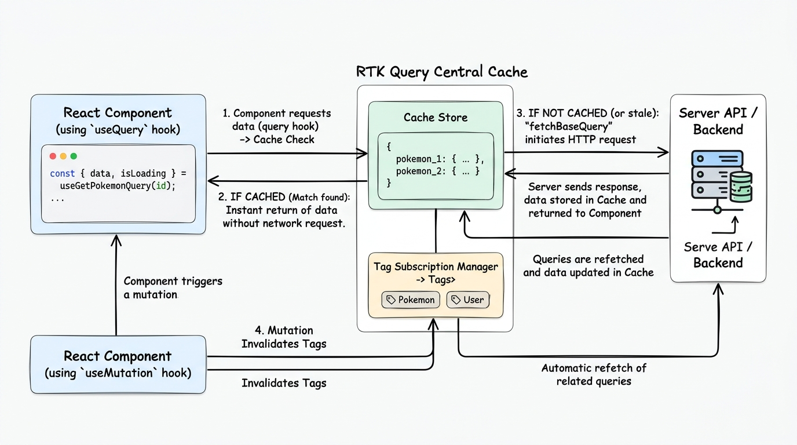

### Complete Working Example

#### 1. API Slice (`store/apiSlice.js`)
```js
import { createApi, fetchBaseQuery } from "@reduxjs/toolkit/query/react";

export const apiSlice = createApi({
  reducerPath: "api",
  baseQuery: fetchBaseQuery({ baseUrl: "https://jsonplaceholder.typicode.com" }),
  tagTypes: ["Posts"],
  endpoints: (builder) => ({
    getPosts: builder.query({
      query: () => "/posts",
      providesTags: ["Posts"],
    }),
    addPost: builder.mutation({
      query: (newPost) => ({
        url: "/posts",
        method: "POST",
        body: newPost,
      }),
      invalidatesTags: ["Posts"],
    }),
  }),
});

export const { useGetPostsQuery, useAddPostMutation } = apiSlice;
```

#### 2. Configure Store (`store/store.js`)
```js
import { configureStore } from "@reduxjs/toolkit";
import { apiSlice } from "./apiSlice";

export const store = configureStore({
  reducer: {
    [apiSlice.reducerPath]: apiSlice.reducer,
  },
  middleware: (getDefaultMiddleware) =>
    getDefaultMiddleware().concat(apiSlice.middleware),
});
```

#### 3. Consuming Query & Mutation in Components
```jsx
// Posts.jsx
import { useGetPostsQuery } from "./store/apiSlice";

function Posts() {
  const { data, isLoading, error } = useGetPostsQuery();

  if (isLoading) return <h2>Loading...</h2>;
  if (error) return <h2>Error loading posts</h2>;

  return (
    <ul>
      {data?.slice(0, 10).map((post) => (
        <li key={post.id}>{post.title}</li>
      ))}
    </ul>
  );
}

// AddPost.jsx
import { useAddPostMutation } from "./store/apiSlice";

function AddPost() {
  const [addPost, { isLoading }] = useAddPostMutation();

  const handleAddPost = async () => {
    try {
      await addPost({ title: "Hello", body: "New Post Content", userId: 1 }).unwrap();
    } catch (err) {
      console.error("Failed to add post:", err);
    }
  };

  return (
    <button onClick={handleAddPost} disabled={isLoading}>
      {isLoading ? "Adding..." : "Add Post"}
    </button>
  );
}
```

> **Lifecycle Flow:** Component calls hook → `fetchBaseQuery` calls API → Result saved in RTK Query Cache → Component receives data → Mutation invalidates tag → Automatic re-fetch.

---

# Normalized State & Entity Adapter

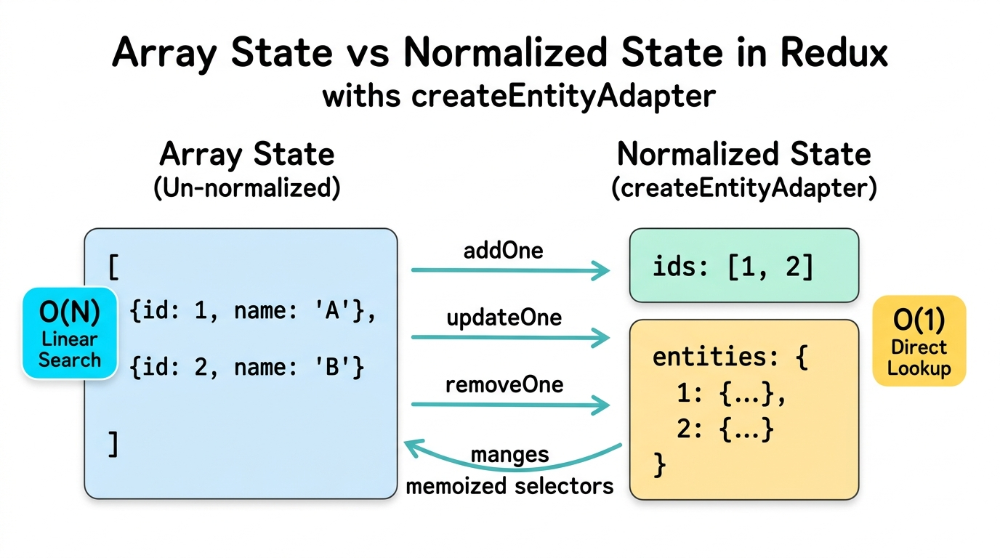

## 1. The Core Problem: Why Do We Need Normalization?

When managing large collections of data (e.g. hundreds or thousands of users or posts) as standard flat arrays (`[{ id: 1 }, { id: 2 }, ...]`), two major problems arise:

1. **Performance Bottleneck ($O(N)$ Search Time):**
   - Finding, updating, or deleting an item requires looping through the array with `array.find()` or `array.filter()`.
   - On large datasets, this linear search takes **$O(N)$ time** and slows down the app.

2. **Update Complexity & Unnecessary Re-renders:**
   - In Redux, state is immutable. Modifying one single item in a flat array requires creating a new copy of the entire array.
   - This changes the reference of the whole list, triggering unnecessary re-renders across components even if their item didn't change.

---

## 2. The Solution: Normalized State Concept

**Normalized State** organizes unstructured lists into a clean two-part structure (similar to a database table):

1. **`ids` (Order Array):** An array of ID keys keeping the exact display order:
   ```json
   [1, 2, 3]
   ```
2. **`entities` (Lookup Dictionary):** An object map where each key is an ID and value is the full item data:
   ```json
   {
     "1": { "id": 1, "name": "Leanne Graham", "email": "sincere@april.biz" },
     "2": { "id": 2, "name": "Ervin Howell", "email": "shanna@melissa.tv" }
   }
   ```

> **Key Benefit:** Accessing, updating, or deleting any item is instant at **$O(1)$ time complexity** (`state.entities[id]`), without scanning through the array!

---

## 3. What is `createEntityAdapter`?

`createEntityAdapter` is an official utility provided by **Redux Toolkit** to manage normalized state with zero manual boilerplate.

### What it provides:
- **Standard Initial State:** Generates `{ ids: [], entities: {} }` plus your custom fields (e.g. `loading`, `error`).
- **Built-in CRUD Reducers:** Ready-to-use reducer methods for adding, updating, and removing items.
- **Automatic Sorting:** Keeps the `ids` array sorted at all times using `sortComparer`.
- **Pre-generated Memoized Selectors:** High-performance selectors (`selectAll`, `selectById`, etc.) ready for `useSelector`.

```mermaid
flowchart LR
    subgraph Reducers["CRUD Reducers (Write)"]
        direction TB
        R1["setAll / setMany"]
        R2["addOne / addMany"]
        R3["updateOne / updateMany"]
        R4["upsertOne / upsertMany"]
        R5["removeOne / removeAll"]
    end

    subgraph State["Normalized Store"]
        direction TB
        ID["ids: [1, 2, 3] (Sorted Order)"]
        ENT["entities: { 1: {...}, 2: {...} } (O(1) Map)"]
    end

    subgraph Selectors["Memoized Selectors (Read)"]
        direction TB
        S1["selectAll -> Sorted Array for UI"]
        S2["selectById -> O(1) Direct Lookup"]
        S3["selectIds -> Array of IDs"]
        S4["selectEntities -> Dictionary Map"]
        S5["selectTotal -> Total Items Count"]
    end

    Reducers -->|Mutate & Sort| State
    State -->|Extract & Memoize| Selectors
```

---

## 4. Built-in CRUD Methods Reference

All adapter methods can be used directly as slice reducers or inside `extraReducers`. Each method operates in optimal time complexity:

- **`setAll(state, items)`** `O(N log N)`  
  Clears all existing items and loads a new list in sorted, normalized shape.
- **`setOne(state, item)`** `O(1)`  
  Adds a new item or completely replaces it if it already exists.
- **`setMany(state, items)`** `O(K)`  
  Adds or completely replaces multiple items at once.
- **`addOne(state, item)`** `O(1)`  
  Adds a single new item. Does nothing if the ID already exists.
- **`addMany(state, items)`** `O(K)`  
  Adds multiple new items at once.
- **`updateOne(state, { id, changes })`** `O(1)`  
  Updates specific fields of an existing item using `{ id, changes }`.
- **`updateMany(state, updates)`** `O(K)`  
  Updates specific fields of multiple existing items.
- **`upsertOne(state, item)`** `O(1)`  
  Smart insert: adds the item if new, or merges updates if it already exists.
- **`upsertMany(state, items)`** `O(K)`  
  Smart insert or update for multiple items at once.
- **`removeOne(state, id)`** `O(1)`  
  Deletes a single item by its ID.
- **`removeMany(state, [ids])`** `O(K)`  
  Deletes multiple items by their IDs.
- **`removeAll(state)`** `O(1)`  
  Empties the entire store (clears `ids` and `entities`).

---

## 5. Built-in Memoized Selectors Reference

Calling `adapter.getSelectors((state) => state.feature)` generates optimized memoized selectors:

- **`selectAll`** *(Returns Array)*  
  Array of all entity objects in sorted order. Perfect for rendering lists in UI with `.map()`.
- **`selectById`** *(Returns Object | undefined)*  
  Single item object matching the given ID. Ideal for detail views or cards.
- **`selectIds`** *(Returns Array)*  
  Array of all IDs (`[1, 2, 3]`). Used for checking item existence or ID-only rendering.
- **`selectEntities`** *(Returns Dictionary Object)*  
  Lookup dictionary (`{ [id]: entity }`). Perfect for fast $O(1)$ lookups in custom selectors.
- **`selectTotal`** *(Returns Number)*  
  Total number of stored entities. Great for badge counts (e.g. "Total Users: 10").

---

## 6. Complete Practical Example (`Entity.js`)

Here is the complete implementation matching [`src/store/Entity.js`](file:///d:/directState/src/store/Entity.js):

```javascript
// src/store/Entity.js
import { createSlice, createEntityAdapter, createAsyncThunk } from '@reduxjs/toolkit';
import axios from 'axios';

// 1. Create the adapter with auto-sorting by name
const AllPosts = createEntityAdapter({
  sortComparer: (a, b) => a.name.localeCompare(b.name), // Automatic sorting based on name
});

// 2. Generate initial state with custom flags (loading, error)
const initialState = AllPosts.getInitialState({
  loading: false,
  error: null,
});

// 3. Async Thunk to fetch data from API
export const fetchUser = createAsyncThunk("user/fetchUser", async () => {
  const response = await axios.get("https://jsonplaceholder.typicode.com/users");
  return response.data;
});

// 4. Create Slice using built-in adapter methods
export const AllPostsSlice = createSlice({
  name: 'AllPosts',
  initialState,
  reducers: {
    // Adapter Built-in Methods maintain sorted order automatically
    addOne: AllPosts.addOne,
    addMany: AllPosts.addMany,
    updateOne: AllPosts.updateOne,
    removeOne: AllPosts.removeOne,
    removeAll: AllPosts.removeAll,
  },
  extraReducers: (builder) => {
    builder
      .addCase(fetchUser.pending, (state) => {
        state.loading = true;
        state.error = null;
      })
      .addCase(fetchUser.fulfilled, (state, action) => {
        state.loading = false;
        // setAll normalizes and sorts all items automatically
        AllPosts.setAll(state, action.payload);
      })
      .addCase(fetchUser.rejected, (state) => {
        state.loading = false;
        state.error = "Something Went Wrong";
      });
  },
});

export const { addOne, addMany, updateOne, removeOne, removeAll } = AllPostsSlice.actions;
export default AllPostsSlice.reducer;

// 5. Adapter Built-in Selectors
export const {
  selectAll: selectAllPosts,   // returns all posts in sorted array
  selectById: selectPostById,  // returns post by id in O(1)
  selectIds: selectPostIds,    // returns all ids
} = AllPosts.getSelectors((state) => state.AllPosts);
```

### Component Usage Example

```jsx
import React, { useEffect } from 'react';
import { useSelector, useDispatch } from 'react-redux';
import { 
  fetchUser, 
  selectAllPosts, 
  selectPostById, 
  removeOne, 
  updateOne 
} from './store/Entity';

function UsersComponent() {
  const dispatch = useDispatch();
  const users = useSelector(selectAllPosts);
  const { loading, error } = useSelector((state) => state.AllPosts);

  useEffect(() => {
    dispatch(fetchUser());
  }, [dispatch]);

  if (loading) return <h2>Loading...</h2>;
  if (error) return <h2>{error}</h2>;

  return (
    <div>
      <h2>Users List (Sorted by Name)</h2>
      <ul>
        {users.map((user) => (
          <li key={user.id}>
            <strong>{user.name}</strong> — {user.email}
            <button onClick={() => dispatch(removeOne(user.id))}>Delete</button>
            <button onClick={() => dispatch(updateOne({ id: user.id, changes: { name: `${user.name} (Updated)` } }))}>
              Update
            </button>
          </li>
        ))}
      </ul>
    </div>
  );
}

export default UsersComponent;
```

---

# Redux Toolkit — Project Architecture

Organize your project by **features** rather than technical layers. Each feature owns its slice, selectors, and API endpoints.

```text
src/
├── app/
│   └── store.js              # Central Redux store configuration
├── services/
│   └── api.js                # Base RTK Query service (baseUrl, tagTypes)
├── features/
│   ├── auth/
│   │   ├── authSlice.js
│   │   └── authApi.js
│   ├── courses/
│   │   ├── coursesSlice.js
│   │   └── coursesApi.js     # Injected endpoints for courses
│   └── users/
│       ├── usersSlice.js
│       └── usersApi.js       # Injected endpoints for users
└── components/
```

### 1. Base API & Code-Splitting (`injectEndpoints`)
Instead of multiple API instances, create one empty base API and let each feature inject its own endpoints:

```js
// services/api.js
import { createApi, fetchBaseQuery } from "@reduxjs/toolkit/query/react";

export const api = createApi({
  reducerPath: "api",
  baseQuery: fetchBaseQuery({ baseUrl: "/api" }),
  tagTypes: ["Courses", "Users", "Auth"],
  endpoints: () => ({}),
});
```

```js
// features/courses/coursesApi.js
import { api } from "../../services/api";

export const coursesApi = api.injectEndpoints({
  endpoints: (builder) => ({
    getCourses: builder.query({
      query: () => "/courses",
      providesTags: ["Courses"],
    }),
    addCourse: builder.mutation({
      query: (course) => ({
        url: "/courses",
        method: "POST",
        body: course,
      }),
      invalidatesTags: ["Courses"],
    }),
  }),
});

export const { useGetCoursesQuery, useAddCourseMutation } = coursesApi;
```

### 2. Central Store Combining Features & Injected API
```js
// app/store.js
import { configureStore } from "@reduxjs/toolkit";
import { api } from "../services/api";
import authReducer from "../features/auth/authSlice";
import coursesReducer from "../features/courses/coursesSlice";

export const store = configureStore({
  reducer: {
    auth: authReducer,
    courses: coursesReducer,
    [api.reducerPath]: api.reducer,
  },
  middleware: (getDefaultMiddleware) =>
    getDefaultMiddleware().concat(api.middleware),
});
```

> **Key Rule:** Features own their domain logic (`Slice` + `Selectors` + `Endpoints`), while `store.js` and `api.js` act as the glue combining them.

---

# TanStack React Query

**TanStack Query (React Query)** is a powerful server-state management library for React. It manages asynchronous server data, caching, background synchronization, deduplication, and loading/error states with minimal code.

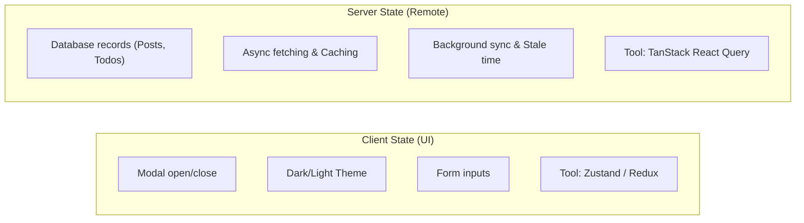

---

## 1. Setup & Configuration

### `queryClient.js`
Define a centralized `QueryClient` instance to set default behaviors across all queries:

```js
import { QueryClient } from "@tanstack/react-query";

export const queryClient = new QueryClient({
  defaultOptions: {
    queries: {
      staleTime: 1000 * 60 * 5,    // Data remains fresh for 5 minutes (no background refetch during this time)
      gcTime: 1000 * 60 * 10,      // Unused cache stays in memory for 10 minutes before Garbage Collection
      refetchOnWindowFocus: false, // Prevents automatic refetch when the user refocuses the browser window
      retry: 3,                    // Automatically retries failed queries up to 3 times
    },
  },
});
```

### Wrapping the Application (`main.jsx`)
Wrap the React root with `QueryClientProvider` and activate `ReactQueryDevtools`:

```jsx
import { StrictMode } from "react";
import { createRoot } from "react-dom/client";
import { QueryClientProvider } from "@tanstack/react-query";
import { ReactQueryDevtools } from "@tanstack/react-query-devtools";
import { queryClient } from "./react-query/queryClient.js";
import App from "./App.jsx";

createRoot(document.getElementById("root")).render(
  <StrictMode>
    <QueryClientProvider client={queryClient}>
      <App />
      <ReactQueryDevtools initialIsOpen={false} />
    </QueryClientProvider>
  </StrictMode>
);
```

---

## 2. Advanced `useQuery` Anatomy (Fetching & Reading Data)

The `useQuery` hook manages reading, caching, and auto-syncing remote data.

```js
const {
  data: todos,
  isLoading,
  isError,
  error,
  isFetching,
  isStale,
  status,
  fetchStatus,
  refetch,
  dataUpdatedAt,
} = useQuery({
  queryKey: ["todos", filter],
  queryFn: fetchTodos,
  staleTime: 1000 * 60 * 2,    // 2 minutes fresh
  gcTime: 1000 * 60 * 10,      // 10 minutes cache retention
  refetchOnWindowFocus: true,  // Auto refetch on tab focus
  retry: 3,                    // Retry 3 times on failure
  retryDelay: (attempt) => Math.min(1000 * 2 ** attempt, 30000), // Exponential backoff
  select: (data) => data.map(todo => ({ ...todo, titleUpper: todo.title.toUpperCase() })),
});
```

### Advanced `useQuery` Options Explained

- **`queryKey`** *(Array — e.g. `['todos', filter]`)*  
  The unique identifier for this cache entry in memory. Accepts an array with dynamic variables for automatic cache segmentation.
- **`queryFn`** *(Async Function — e.g. `fetchTodos`)*  
  The async function that fetches data. It automatically receives an object containing `{ queryKey, signal }`.
- **`staleTime`** *(Number in ms — e.g. `1000 * 60 * 2` [2 mins])*  
  How long the data is considered **fresh**. While fresh, React Query serves from memory instantly without network requests.
- **`gcTime`** *(Number in ms — e.g. `1000 * 60 * 10` [10 mins])*  
  *(Formerly `cacheTime`)*. How long unused/inactive cache data stays in memory before garbage collection cleans it up.
- **`refetchOnWindowFocus`** *(Boolean — `true`)*  
  Automatically refetches fresh data whenever the user switches back to the browser tab or app window.
- **`retry`** *(Number or Boolean — e.g. `3`)*  
  Number of retry attempts if an HTTP request fails before reporting an error to the UI.
- **`retryDelay`** *(Function or Number — e.g. exponential backoff)*  
  Delay between retry attempts: `(attempt) => Math.min(1000 * 2 ** attempt, 30000)`.
- **`select`** *(Function — e.g. `(data) => data.map(...)`)*  
  Transforms or memoizes data on the fly before handing it to the component. Saves unnecessary UI re-renders.

### `staleTime` vs `gcTime` Timeline

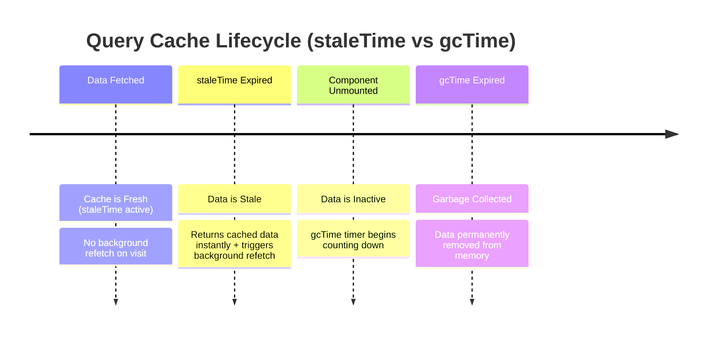

---

## 3. Query Return Properties & States

### `isLoading` vs `isFetching`

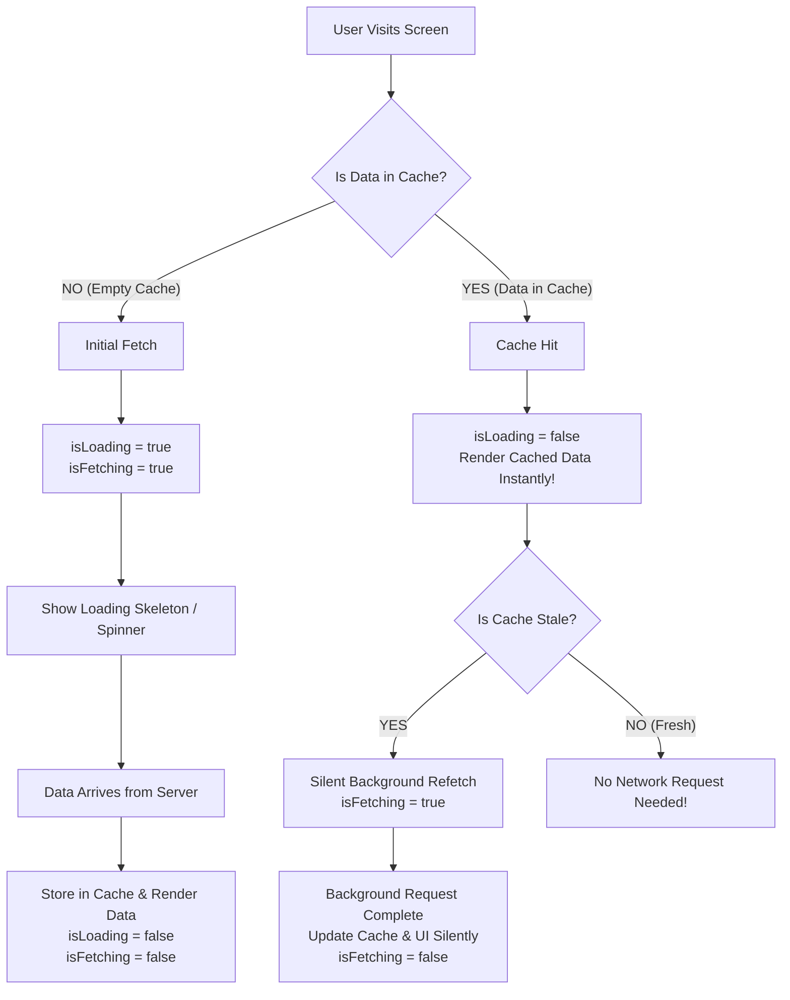

### `status` vs `fetchStatus`
In TanStack Query v5, states are separated into two distinct dimensions:
- **`status`**: Represents the **data availability**:
  - `'pending'`: No data is available yet.
  - `'error'`: An error happened.
  - `'success'`: Data was fetched successfully.
- **`fetchStatus`**: Represents the **network activity**:
  - `'fetching'`: An active HTTP request is in progress.
  - `'paused'`: The query wanted to fetch, but there is no internet connection.
  - `'idle'`: No network request is running right now.

### Other Useful Properties
- **`isStale`**: Boolean flag showing if the data has exceeded its `staleTime`.
- **`dataUpdatedAt`**: Timestamp (number in ms) of when the data was last successfully fetched. Use `new Date(dataUpdatedAt).toLocaleTimeString()` to show the user the last updated time!
- **`refetch`**: Manual trigger function to force a refetch on demand (e.g. Refresh button).

---

## 4. Global Monitoring Hooks

TanStack Query provides global monitoring hooks to track activity across the entire application:

```js
import { useIsFetching, useIsMutating } from "@tanstack/react-query";

// 1. Returns number of queries currently fetching anywhere in the app
const globalIsFetchingCount = useIsFetching();

// 2. Returns number of mutations currently executing anywhere in the app
const globalIsMutatingCount = useIsMutating();
```

> **Use Case:** Perfect for displaying global loading spinners, status badges, or network sync bars in your application header.

---

## 5. The Power of `queryKey` & Parameters

The `queryKey` is the unique cache identifier:

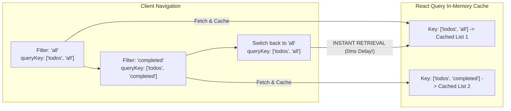

### Accessing `queryKey` inside `queryFn`:
You can read parameters directly from `queryKey` inside `queryFn`:

```js
const fetchTodos = async ({ queryKey }) => {
  const [, filter] = queryKey; // Extracts 'filter' parameter
  const response = await axios.get("https://jsonplaceholder.typicode.com/todos", {
    params: {
      _limit: 5,
      completed: filter === "completed" ? true : filter === "active" ? false : undefined,
    },
  });
  return response.data;
};
```

---

## 6. `useMutation` (Creating, Updating & Deleting Data)

While `useQuery` is for **reading data**, `useMutation` is for **writing data and side effects** (POST, PUT, PATCH, DELETE).

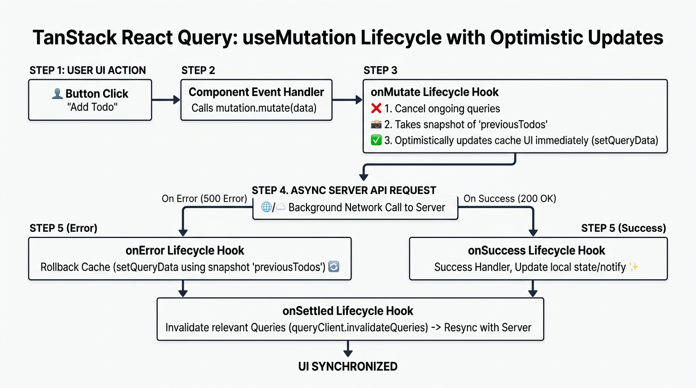

### Core Anatomy of `useMutation`

```js
const mutation = useMutation({
  mutationFn: async (newTodo) => {
    return await axios.post("/api/todos", newTodo);
  },
  onMutate: async (variables) => {
    // 1. Runs BEFORE mutation executes (used for Optimistic Updates & Snapshotting)
    // Whatever is returned here becomes the 'context' in onError and onSettled!
    return { rollbackData };
  },
  onError: (error, variables, context) => {
    // 2. Runs if server request fails -> Revert cache using context!
  },
  onSuccess: (data, variables, context) => {
    // 3. Runs on server success (2xx HTTP response)
  },
  onSettled: (data, error, variables, context) => {
    // 4. Runs ALWAYS when finished (success or failure, like 'finally')
    // -> Invalidate queries to resync cache with server!
  },
});
```

---

## 7. Deep Dive: Optimistic Updates, Context Rollback & Cache Mechanics

**Optimistic Updates** make your application feel instantaneous by updating the local UI cache immediately before the server responds. If the server request fails, the UI rolls back cleanly to the pre-mutation snapshot.

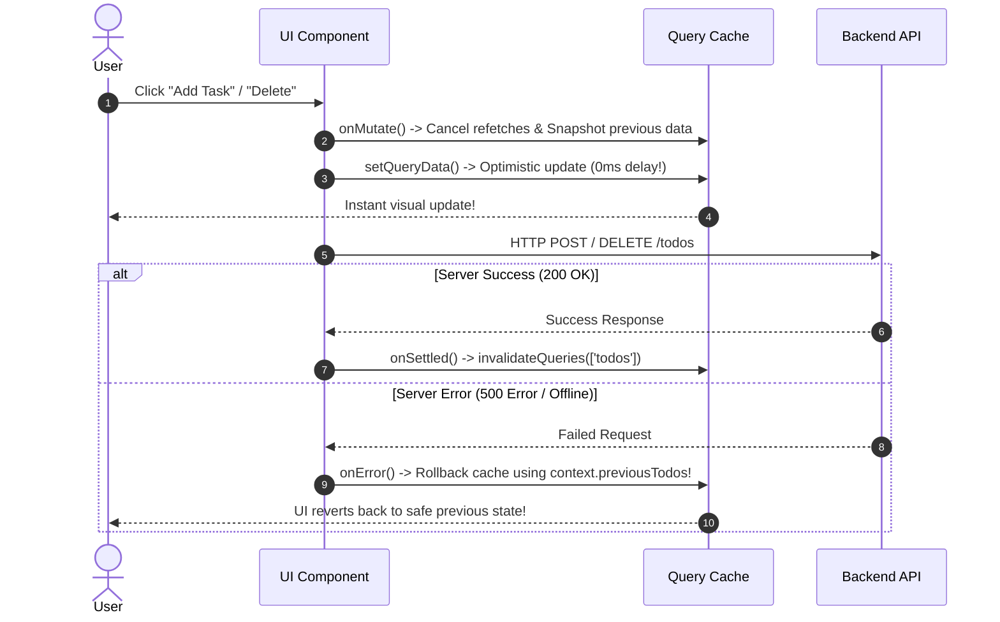

### Essential Architectural Concepts Explained

#### 1. Why `return { previousTodos }` in `onMutate`? (The Context Pipeline)
- **The Context Mechanism:** Whatever object is returned from `onMutate` is automatically captured by TanStack Query and passed as the 3rd argument (`context`) to both `onError(err, variables, context)` and `onSettled(data, error, variables, context)`.
- **The Snapshot:**
  ```js
  const previousTodos = queryClient.getQueryData(['todos', filter]);
  return { previousTodos };
  ```
- **The Rollback on Failure:**
  ```js
  onError: (err, newTodo, context) => {
    // Restores the previous cache state if network fails or server throws 500
    queryClient.setQueryData(['todos', filter], context.previousTodos);
  }
  ```
  If you don't return `{ previousTodos }`, `context` will be `undefined`, making it impossible to roll back the UI if the network request fails.

---

#### 2. Why `(old = []) => ...` Default Value? (Defensive Cache Guard)
- **The Problem:** If the query hasn't completed its initial fetch, if the user navigated directly to the page, or if the cache was invalidated/cleared, `queryClient.getQueryData(['todos', filter])` returns `undefined`.
- **What happens without the default?**
  - In addition: `[newItem, ...old]` becomes `[newItem, ...undefined]`, which throws `TypeError: old is not iterable`.
  - In deletion: `old.filter(...)` becomes `undefined.filter(...)`, which crashes with `TypeError: Cannot read properties of undefined (reading 'filter')`.
- **The Solution:**
  ```js
  queryClient.setQueryData(['todos', filter], (old = []) => [
    newItem,
    ...old,
  ]);
  ```
  Setting `(old = [])` ensures `old` is always a valid array, protecting your application from runtime crashes under cold cache states.

---

#### 3. Understanding `filter`: Cache Segmentation vs. Prefix Invalidation
- **Cache Segmentation by `queryKey`:**
  In TanStack Query, the array `['todos', filter]` creates separate, independent cache slots in memory for each unique filter value:
  - Cache 1: `['todos', 'all']`
  - Cache 2: `['todos', 'active']`
  - Cache 3: `['todos', 'completed']`
- **Why `setQueryData` uses `['todos', filter]`:**
  During `onMutate`, the user is currently looking at their active screen (e.g. `'all'`). Updating `['todos', filter]` gives the user **0ms instant visual feedback** on the active view.
- **Why `onSettled` calls `invalidateQueries({ queryKey: ['todos'] })` WITHOUT `filter`:**
  TanStack Query uses **prefix (fuzzy) matching** by default!
  Specifying only `['todos']` automatically matches and invalidates **ALL** queries starting with `['todos']`:
  - `['todos', 'all']` ➔ Marked stale & refetched
  - `['todos', 'active']` ➔ Marked stale & refetched
  - `['todos', 'completed']` ➔ Marked stale & refetched
  This guarantees that once the server operation completes, all lists across the entire system stay 100% in sync with the database without needing to manually update each filter variant!

---

### 3 Practical Mutation Patterns

#### Pattern A: Add Item (POST) with Optimistic Update & Rollback
```js
const addMutation = useMutation({
  mutationFn: (newTodo) => axios.post("/api/todos", newTodo),

  // Step 1: Optimistic Update before request
  onMutate: async (newTodoVariables) => {
    await queryClient.cancelQueries({ queryKey: ["todos", filter] });
    const previousTodos = queryClient.getQueryData(["todos", filter]);

    // Optimistically update cache with temporary ID & defensive default array
    queryClient.setQueryData(["todos", filter], (old = []) => [
      { id: Date.now(), title: newTodoVariables.title, completed: false },
      ...old,
    ]);

    // Return context with snapshot for rollback
    return { previousTodos };
  },

  // Step 2: Rollback on error
  onError: (err, newTodo, context) => {
    queryClient.setQueryData(["todos", filter], context?.previousTodos);
    console.error("Mutation failed, rolled back:", err.message);
  },

  // Step 3: Always re-sync with server
  onSettled: () => {
    queryClient.invalidateQueries({ queryKey: ["todos"] });
  },

  onSuccess: () => {
    setNewTitle("");
  },
});
```

#### Pattern B: Update Item (PUT / PATCH)
```js
const updateMutation = useMutation({
  mutationFn: (updatedTodo) =>
    axios.put(`/api/todos/${updatedTodo.id}`, updatedTodo),
  onSuccess: () => {
    // Invalidate query to trigger automatic background refetch
    queryClient.invalidateQueries({ queryKey: ["todos"] });
  },
});
```

#### Pattern C: Delete Item (DELETE) with Optimistic Removal
```js
const deleteMutation = useMutation({
  mutationFn: (id) => axios.delete(`/api/todos/${id}`),

  onMutate: async (deletedId) => {
    await queryClient.cancelQueries({ queryKey: ["todos", filter] });
    const previousTodos = queryClient.getQueryData(["todos", filter]);

    // Immediately remove item from local cache
    queryClient.setQueryData(["todos", filter], (old = []) =>
      old.filter((todo) => todo.id !== deletedId)
    );

    return { previousTodos };
  },

  onError: (err, deletedId, context) => {
    // Revert deletion if server request fails
    queryClient.setQueryData(["todos", filter], context?.previousTodos);
  },

  onSettled: () => {
    queryClient.invalidateQueries({ queryKey: ["todos"] });
  },
});
```

---

## 8. Triggering Mutations (`mutate` vs `mutateAsync`)

- **`mutate(variables, { onSuccess, onError })`** *(Returns `void`)*  
  The standard, fire-and-forget way to execute mutations. Success and error handling are managed via callbacks. Does not throw errors to the caller.
- **`mutateAsync(variables)`** *(Returns `Promise<TData>`)*  
  Returns a standard Promise. Use when you need `await` or `try/catch` directly inside an async event handler (e.g. awaiting an API response before redirecting or coordinating chained requests).

---

## 9. Complete Working Component Logic (`useMutationExampple.jsx`)

Here is the reference implementation demonstrating `useQuery`, `useMutation`, Optimistic Updates, filters, and global monitoring (refer to [`src/react-query/useMutationExampple.jsx`](file:///d:/directState/src/react-query/useMutationExampple.jsx) for the interactive UI):

```jsx
import { useState } from 'react';
import { 
    useQuery, 
    useMutation, 
    useQueryClient, 
    useIsFetching, 
    useIsMutating 
} from '@tanstack/react-query';
import axios from 'axios';

const fetchTodos = async ({ queryKey }) => {
    const [, filter] = queryKey;
    const response = await axios.get('https://jsonplaceholder.typicode.com/todos', {
        params: { _limit: 5, completed: filter === 'completed' ? true : filter === 'active' ? false : undefined }
    });
    return response.data;
};

const addTodoItem = async (newTodo) => {
    const response = await axios.post('https://jsonplaceholder.typicode.com/todos', newTodo);
    return response.data;
};

const updateTodoItem = async (updatedTodo) => {
    const response = await axios.put(`https://jsonplaceholder.typicode.com/todos/${updatedTodo.id}`, updatedTodo);
    return response.data;
};

const deleteTodoItem = async (id) => {
    await axios.delete(`https://jsonplaceholder.typicode.com/todos/${id}`);
    return id;
};

export default function CompleteReactQueryComponent() {
    const [filter, setFilter] = useState('all');
    const [newTitle, setNewTitle] = useState('');
    const queryClient = useQueryClient();

    // Global monitoring hooks
    const globalIsFetchingCount = useIsFetching();
    const globalIsMutatingCount = useIsMutating();

    // useQuery with advanced options
    const {
        data: todos,
        isLoading,
        isError,
        error,
        isFetching,
        isStale,
        status,
        fetchStatus,
        refetch,
        dataUpdatedAt
    } = useQuery({
        queryKey: ['todos', filter],
        queryFn: fetchTodos,
        staleTime: 1000 * 60 * 2,
        gcTime: 1000 * 60 * 10,
        refetchOnWindowFocus: true,
        retry: 3,
        retryDelay: (attemptIndex) => Math.min(1000 * 2 ** attemptIndex, 30000),
        select: (data) => data.map(todo => ({ ...todo, titleUppercase: todo.title.toUpperCase() }))
    });

    // useMutation: Add Item (POST) with Optimistic Update
    const addMutation = useMutation({
        mutationFn: addTodoItem,
        onMutate: async (newTodoVariables) => {
            await queryClient.cancelQueries({ queryKey: ['todos', filter] });
            const previousTodos = queryClient.getQueryData(['todos', filter]);

            queryClient.setQueryData(['todos', filter], (old = []) => [
                { id: Date.now(), title: newTodoVariables.title, completed: false, titleUppercase: newTodoVariables.title.toUpperCase() },
                ...old,
            ]);

            return { previousTodos };
        },
        onError: (err, newTodo, context) => {
            queryClient.setQueryData(['todos', filter], context?.previousTodos);
            console.error('Mutation failed, rolled back:', err.message);
        },
        onSettled: () => {
            queryClient.invalidateQueries({ queryKey: ['todos'] });
        },
        onSuccess: () => {
            setNewTitle('');
        }
    });

    // useMutation: Update Item (PUT)
    const updateMutation = useMutation({
        mutationFn: updateTodoItem,
        onSuccess: () => {
            queryClient.invalidateQueries({ queryKey: ['todos'] });
        }
    });

    // useMutation: Delete Item (DELETE) with Optimistic Removal
    const deleteMutation = useMutation({
        mutationFn: deleteTodoItem,
        onMutate: async (deletedId) => {
            await queryClient.cancelQueries({ queryKey: ['todos', filter] });
            const previousTodos = queryClient.getQueryData(['todos', filter]);

            queryClient.setQueryData(['todos', filter], (old = []) => 
                old.filter(todo => todo.id !== deletedId)
            );

            return { previousTodos };
        },
        onError: (err, deletedId, context) => {
            queryClient.setQueryData(['todos', filter], context?.previousTodos);
        },
        onSettled: () => {
            queryClient.invalidateQueries({ queryKey: ['todos'] });
        }
    });

    const handleAddSubmit = (e) => {
        e.preventDefault();
        if (!newTitle.trim()) return;
        addMutation.mutate({ title: newTitle, completed: false, userId: 1 });
    };

    const handleToggleComplete = (todo) => {
        updateMutation.mutate({ ...todo, completed: !todo.completed });
    };

    if (isLoading) return <div>Loading...</div>;
    if (isError) return <div>Error: {error.message}</div>;

    // Full UI rendering logic available in src/react-query/useMutationExampple.jsx
    return null;
}
```

---

# 10. Pagination with React Query (TanStack Query)

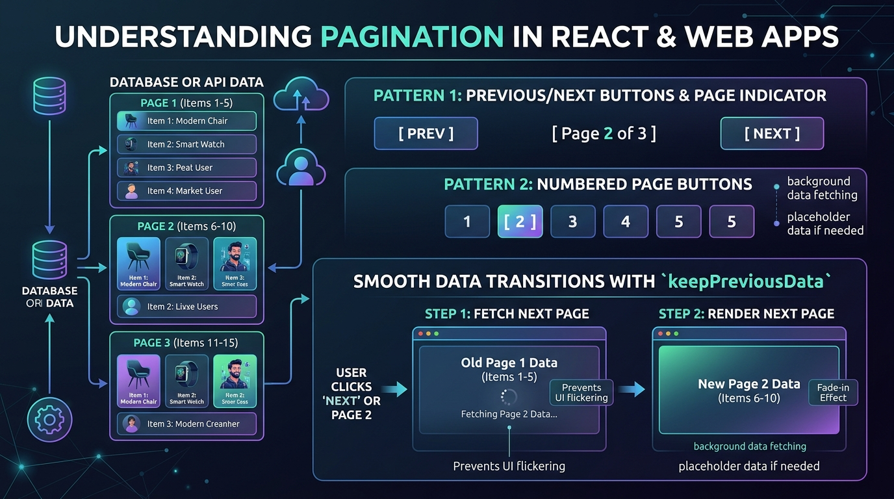

### What is Pagination?
When an API has many items (like 100 or 1,000 products), we do not load all of them at one time. If we load everything at once, the app becomes slow.  
Instead, we divide the data into **pages** (for example: 5 items per page).

TanStack React Query makes pagination very fast, clean, and smooth.

---

### The Secret Superpower: `placeholderData: keepPreviousData`

In regular React, when you change the page:
1. The current list disappears immediately.
2. A loading spinner flashes on the screen.
3. The new page data arrives.
4. **Problem:** The screen jumps and flickers. This is annoying for the user!

With TanStack Query, we add one simple line:
```javascript
placeholderData: keepPreviousData
```

| Without `keepPreviousData` | With `keepPreviousData` |
| :--- | :--- |
| Screen goes blank or shows a loading spinner | Old page stays visible on screen |
| Layout jumps up and down | Smooth transition with no jumps |
| Annoying flickering | Seamless user experience |

> **How it works:** TanStack Query keeps showing the **old page data** until the **new page data** is completely finished downloading in the background.

---

## Method 1: Previous / Next Pagination (`PrevNext`)

In this pattern, the user navigates using two buttons: **Previous Page** and **Next Page**.

### 1. The Query Hook ([`pagination.js`](file:///d:/directState/src/react-query/pagination/PrevNext/pagination.js))
We put `page` inside the `queryKey`: `['products', page]`.  
When `page` changes, React Query knows to fetch that new page or get it instantly from cache if visited before.

```javascript
import { useQuery, keepPreviousData } from '@tanstack/react-query';
import axios from 'axios';

// Fetch function: reads the current page number from queryKey
const fetchProducts = async ({ queryKey }) => {
    const [, page] = queryKey; 
    const response = await axios.get(`https://jsonplaceholder.typicode.com/posts?_page=${page}&_limit=5`);
    return response.data;
};

export function usePaginatedProducts(page) {
    return useQuery({
        queryKey: ['products', page],       // Unique cache for every page!
        queryFn: fetchProducts,
        placeholderData: keepPreviousData, // Keeps old data visible while fetching next page
        staleTime: 1000 * 60 * 5,          // Cache stays fresh for 5 minutes
    });
}
```

### 2. The Component ([`ProductList.jsx`](file:///d:/directState/src/react-query/pagination/PrevNext/ProductList.jsx))
We keep `page` in local React state (`useState(1)`).

```jsx
import { useState } from 'react';
import { usePaginatedProducts } from './pagination.js';

export default function ProductsList() {
    const [page, setPage] = useState(1);

    const { 
        data, 
        isLoading, 
        isError, 
        error, 
        isFetching, 
        isPlaceholderData 
    } = usePaginatedProducts(page);

    // Initial load: only shows on the very first visit
    if (isLoading) return <div>Loading first page... ⏳</div>;
    if (isError) return <div>Error: {error.message}</div>;

    return (
        <div style={{ padding: '20px' }}>
            <h2>Products List (Page {page})</h2>

            {/* Background update indicator */}
            {isFetching && <span style={{ color: 'gray' }}> 🔄 Updating in background...</span>}

            <ul>
                {data.map(product => (
                    <li key={product.id}>{product.title}</li>
                ))}
            </ul>

            <div style={{ marginTop: '20px', display: 'flex', gap: '10px' }}>
                {/* 1. Previous Button */}
                <button 
                    onClick={() => setPage(old => Math.max(old - 1, 1))}
                    disabled={page === 1}
                >
                    Previous Page
                </button>

                <span>Page: {page}</span>

                {/* 2. Next Button */}
                <button 
                    onClick={() => {
                        // Do not allow clicking Next if the next page is still loading
                        if (!isPlaceholderData) {
                            setPage(old => old + 1);
                        }
                    }}
                >
                    Next Page
                </button>
            </div>
        </div>
    );
}
```

### Important Details for Method 1:
- `disabled={page === 1}`: Disables the Previous button on page 1 so you cannot go to page 0.
- `Math.max(old - 1, 1)`: Safe mathematical guard to ensure the page number never goes below 1.
- `!isPlaceholderData`: If data is still loading from the server, `isPlaceholderData` is `true`. Checking this prevents users from spam-clicking the Next button before data arrives.

---

## Method 2: Numbered Page Pagination (`Numbered`)

In this pattern, the user sees all page numbers as buttons: `[1] [2] [3] [4] ... [20]`.  
The user can click any number to jump directly to that page.

### 1. The Query Hook ([`NumberPagination.js`](file:///d:/directState/src/react-query/pagination/Numbered/NumberPagination.js))
To make page numbers, we need to know the **total count** of all items.  
Most APIs send this in the headers (like `x-total-count`) or in the JSON response body.

```javascript
import { useQuery, keepPreviousData } from '@tanstack/react-query';
import axios from 'axios';

const fetchProductsWithTotal = async ({ queryKey }) => {
    const [, page] = queryKey;
    const limit = 5;
    const response = await axios.get(`https://jsonplaceholder.typicode.com/posts?_page=${page}&_limit=${limit}`);
    
    return {
        products: response.data,
        // Read total items from server headers (default to 100 if missing)
        totalCount: parseInt(response.headers['x-total-count'] || '100', 10) 
    };
};

export function usePaginatedProducts(page) {
    return useQuery({
        queryKey: ['products', page],
        queryFn: fetchProductsWithTotal,
        placeholderData: keepPreviousData, // Keeps previous list while loading new page
    });
}
```

### 2. The Component ([`NumberedPaginationComponent.jsx`](file:///d:/directState/src/react-query/pagination/Numbered/NumberedPaginationComponent.jsx))
We calculate how many pages exist using `Math.ceil(totalCount / limit)` and render a button for each page.

```jsx
import { useState } from 'react';
import { usePaginatedProducts } from './NumberPagination.js';

export default function NumberedPaginationComponent() {
    const [page, setPage] = useState(1);
    const limit = 5;

    const { data, isLoading, isError, isFetching } = usePaginatedProducts(page);

    if (isLoading) return <div>Loading...</div>;
    if (isError) return <div>Something went wrong!</div>;

    // 1. Calculate total pages: e.g. 100 items / 5 per page = 20 pages
    const totalPages = Math.ceil((data?.totalCount || 0) / limit);

    // 2. Generate numbers array: [1, 2, 3, 4, ... 20]
    const pagesArray = Array.from({ length: totalPages }, (_, index) => index + 1);

    return (
        <div style={{ padding: '20px' }}>
            <h2>Products (Page {page} of {totalPages})</h2>
            {isFetching && <span style={{ color: 'gray' }}> 🔄 Updating...</span>}

            <ul>
                {data.products.map(product => (
                    <li key={product.id}>{product.title}</li>
                ))}
            </ul>

            {/* Render buttons for each page number */}
            <div style={{ display: 'flex', gap: '5px', marginTop: '20px' }}>
                {pagesArray.map(pageNum => (
                    <button
                        key={pageNum}
                        onClick={() => setPage(pageNum)}
                        style={{
                            padding: '8px 12px',
                            // Highlight the active page in blue
                            backgroundColor: page === pageNum ? '#007bff' : '#f8f9fa',
                            color: page === pageNum ? '#fff' : '#000',
                            border: '1px solid #ccc',
                            cursor: 'pointer'
                        }}
                    >
                        {pageNum}
                    </button>
                ))}
            </div>
        </div>
    );
}
```

### Important Details for Method 2:
- **`Math.ceil((data?.totalCount || 0) / limit)`**: If you have 21 items and 5 items per page, `21 / 5 = 4.2`. `Math.ceil` rounds up to `5` pages so the last item is not lost.
- **`Array.from({ length: totalPages }, (_, index) => index + 1)`**: Creates an array of numbers starting from 1 up to `totalPages`.
- **`page === pageNum`**: Checks if this button matches the current active page to highlight it in blue (`#007bff`).

---

## Comparison Summary: Which Method Should You Use?

| Feature | Method 1: Previous / Next | Method 2: Numbered Pages |
| :--- | :--- | :--- |
| **API requirement** | Only needs current page items | Needs `totalCount` of all items |
| **UI controls** | Simple **[Previous]** and **[Next]** buttons | Number buttons **[1] [2] [3] ...** |
| **Best used for** | Mobile screens, feeds, simple lists | Admin tables, e-commerce product catalogs |
| **Direct jump** | Can only step +1 or -1 page | Can jump directly to any page number |
| **User experience** | Zero flickering with `keepPreviousData` | Zero flickering with `keepPreviousData` |

---

# 11. Infinite Scroll with TanStack React Query (`useInfiniteQuery`)

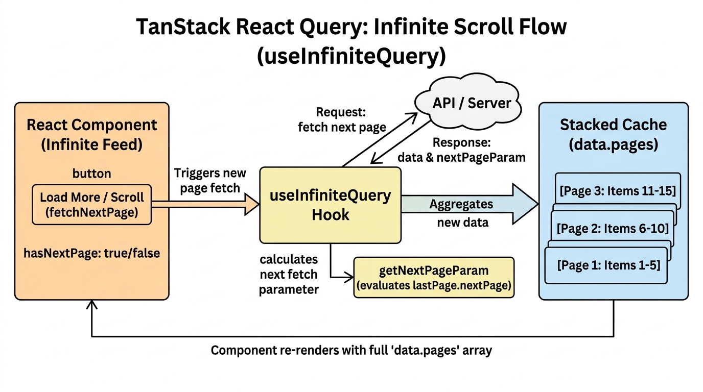

### 1. The Concept: What is Infinite Scroll?
**Infinite Scroll** provides a continuous, seamless content stream—popularized by modern social media feeds like **Instagram**, **TikTok**, and **Twitter/X**.

Instead of navigating with traditional page numbers (`[1] [2] [3]`) where switching pages discards previous content and replaces the entire view, Infinite Scroll loads new batches of data dynamically as the user scrolls near the bottom of the list or clicks a **"Load More"** button.

- **Continuous Feed:** Previously loaded items remain on the screen.
- **Dynamic Appending:** New items are appended seamlessly to the bottom of the existing list.
- **Frictionless UX:** Users stay engaged without manual page clicks or page-switching interruptions.

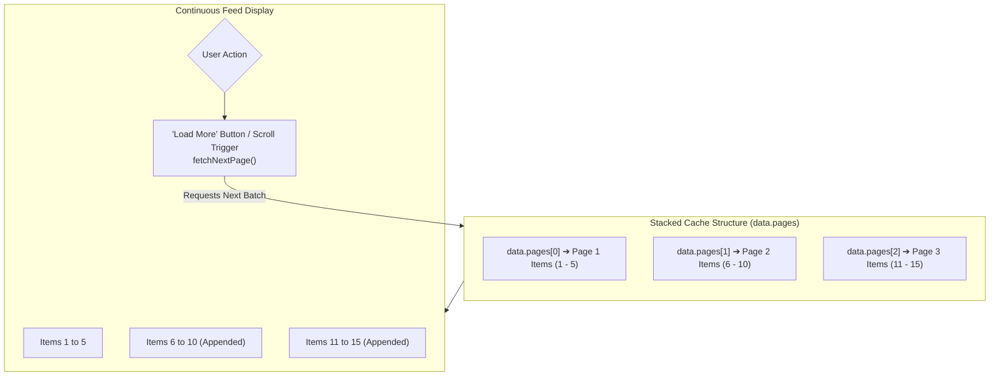

---

### 2. Implementation: Why `useInfiniteQuery` Instead of `useQuery`?

| Hook | Data Structure | Behavior on Next Page Fetch |
| :--- | :--- | :--- |
| **`useQuery`** | Single array or object: `data = [...]` | Overwrites and replaces previous data with the new page |
| **`useInfiniteQuery`** | Stacked pages object: `data.pages = [[...], [...]]` | Retains all previous pages and appends new pages into an array of arrays |

With `useInfiniteQuery`, TanStack Query returns an object containing:
- **`data.pages`**: An array containing the server response for each fetched page:
  ```javascript
  data = {
    pages: [
      { products: [/* items 1..5 */], nextPage: 2 },
      { products: [/* items 6..10 */], nextPage: 3 },
      { products: [/* items 11..15 */], nextPage: undefined } // End of list
    ],
    pageParams: [1, 2, 3] // The param passed to each page query
  };
  ```
- **`data.pageParams`**: An array recording the exact parameters passed to each fetch.

---

### 3. Core Functions & Properties Explained

#### 1. `getNextPageParam`
- **What it is:** A required callback function defined in `useInfiniteQuery` that determines the parameter/page number for the **next** network request.
- **How it works:** It receives `(lastPage, allPages, lastPageParam, allPageParams)`:
  - If more data is available, return the next page number (e.g. `lastPage.nextPage` or `pageParam + 1`).
  - If there are no more items to fetch (e.g. empty array or end reached), return `undefined` or `null`.
  ```javascript
  getNextPageParam: (lastPage, allPages) => {
    // If last page has data, request the next page; otherwise stop
    return lastPage.products.length > 0 ? allPages.length + 1 : undefined;
  }
  ```

#### 2. `hasNextPage`
- **What it is:** A boolean property (`true` or `false`) provided by the hook.
- **How it works:** TanStack Query calculates this automatically based on `getNextPageParam`:
  - `true`: `getNextPageParam` returned a valid page parameter, meaning more pages can be fetched.
  - `false`: `getNextPageParam` returned `undefined`, signaling that the end of the dataset has been reached.
- **Usage:** Used to disable or hide "Load More" buttons, or stop scroll event listeners.

#### 3. `fetchNextPage`
- **What it is:** The trigger function that initiates fetching the next batch of data.
- **How it works:** When invoked, it automatically passes the value calculated by `getNextPageParam` into `queryFn({ pageParam })`.
- **Usage:** Triggered when the user clicks a "Load More" button or when an `IntersectionObserver` detects the bottom sentinel entering the viewport:
  ```jsx
  <button onClick={() => fetchNextPage()}>Load More</button>
  ```

#### 4. `isFetchingNextPage`
- **What it is:** A boolean property distinguishing between the initial query load and loading subsequent pages.
- **Why it matters:** 
  - `isLoading`: `true` only during the **very first page fetch** (cache is empty).
  - `isFetchingNextPage`: `true` only when **fetching subsequent pages**.
  - Prevents accidental duplicate requests and lets you display `"Loading more..."` without replacing existing items.

---

### 4. Simple & Clean Code Example

#### 1. Custom Hook ([`infiniteScroll.js`](file:///d:/directState/src/react-query/infiniteScroll/infiniteScroll.js))

```javascript
import { useInfiniteQuery } from '@tanstack/react-query';
import axios from 'axios';

// Fetch function: receives { pageParam } automatically
const fetchInfiniteProducts = async ({ pageParam = 1 }) => {
    const res = await axios.get(`https://jsonplaceholder.typicode.com/posts?_page=${pageParam}&_limit=5`);
    return {
        products: res.data,
        // If items were returned, next page is pageParam + 1; otherwise undefined
        nextPage: res.data.length > 0 ? pageParam + 1 : undefined,
    };
};

export function useInfiniteProducts() {
    return useInfiniteQuery({
        queryKey: ['infiniteProducts'],
        queryFn: fetchInfiniteProducts,
        initialPageParam: 1, // Starting page parameter (v5 required)
        getNextPageParam: (lastPage) => lastPage.nextPage, // Returns next page or undefined
    });
}
```

#### 2. React Component ([`InfiniteScrollComponent.jsx`](file:///d:/directState/src/react-query/infiniteScroll/InfiniteScrollComponent.jsx))

```jsx
import React from 'react';
import { useInfiniteProducts } from './infiniteScroll';

export default function InfiniteScrollComponent() {
    const {
        data,
        isLoading,
        isError,
        error,
        fetchNextPage,        // Triggers loading the next batch of items
        hasNextPage,          // Boolean: true if there are more pages to load
        isFetchingNextPage    // Boolean: true while fetching the next page
    } = useInfiniteProducts();

    // 1. Initial Load State
    if (isLoading) return <div>Loading first page... ⏳</div>;
    if (isError) return <div>Error loading data: {error.message}</div>;

    return (
        <div style={{ padding: '20px', maxWidth: '600px', margin: '0 auto' }}>
            <h2>Infinite Scroll Feed</h2>

            {/* 2. Render Stacked Pages (Array of Arrays) */}
            <ul style={{ listStyle: 'none', padding: 0 }}>
                {data.pages.map((pageGroup, pageIndex) => (
                    <React.Fragment key={pageIndex}>
                        {pageGroup.products.map((product) => (
                            <li 
                                key={product.id} 
                                style={{ padding: '15px', borderBottom: '1px solid #eee' }}
                            >
                                <strong>#{product.id}</strong> — {product.title}
                            </li>
                        ))}
                    </React.Fragment>
                ))}
            </ul>

            {/* 3. Load More / Infinite Scroll Trigger */}
            <div style={{ textAlign: 'center', marginTop: '20px' }}>
                <button
                    onClick={() => fetchNextPage()}
                    disabled={!hasNextPage || isFetchingNextPage}
                    style={{
                        padding: '10px 24px',
                        cursor: hasNextPage ? 'pointer' : 'not-allowed',
                        borderRadius: '6px',
                        border: '1px solid #ccc',
                        backgroundColor: hasNextPage ? '#007bff' : '#e9ecef',
                        color: hasNextPage ? '#fff' : '#6c757d'
                    }}
                >
                    {isFetchingNextPage
                        ? 'Loading more items... 🔄'
                        : hasNextPage
                        ? 'Load More'
                        : '🎉 End of Products'}
                </button>
            </div>
        </div>
    );
}
```

---

### 5. Summary: Pagination vs. Infinite Scroll

| Feature | Standard Pagination (`useQuery`) | Infinite Scroll (`useInfiniteQuery`) |
| :--- | :--- | :--- |
| **Data Retention** | Old page is discarded/replaced when navigating | All loaded pages stay stacked and visible |
| **Cache Structure** | Single page: `data = [...]` | Array of pages: `data.pages = [[...], [...]]` |
| **Hook Used** | `useQuery` + `keepPreviousData` | `useInfiniteQuery` |
| **Next Step Trigger** | Set page state: `setPage(prev => prev + 1)` | Trigger function: `fetchNextPage()` |
| **Best For** | Admin tables, search results, direct jumps | Social media feeds, mobile apps, product catalogs |


