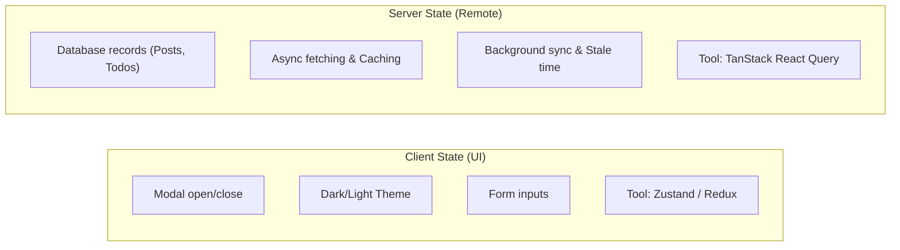
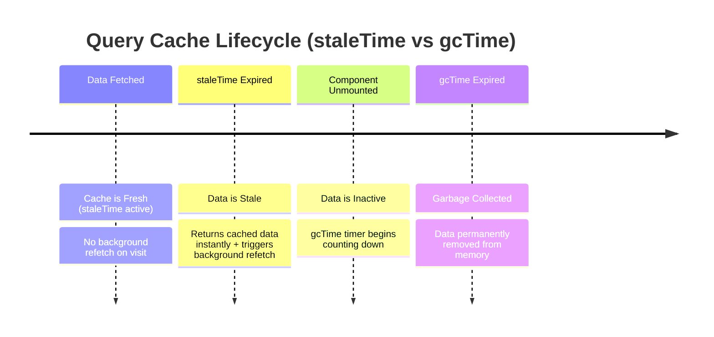
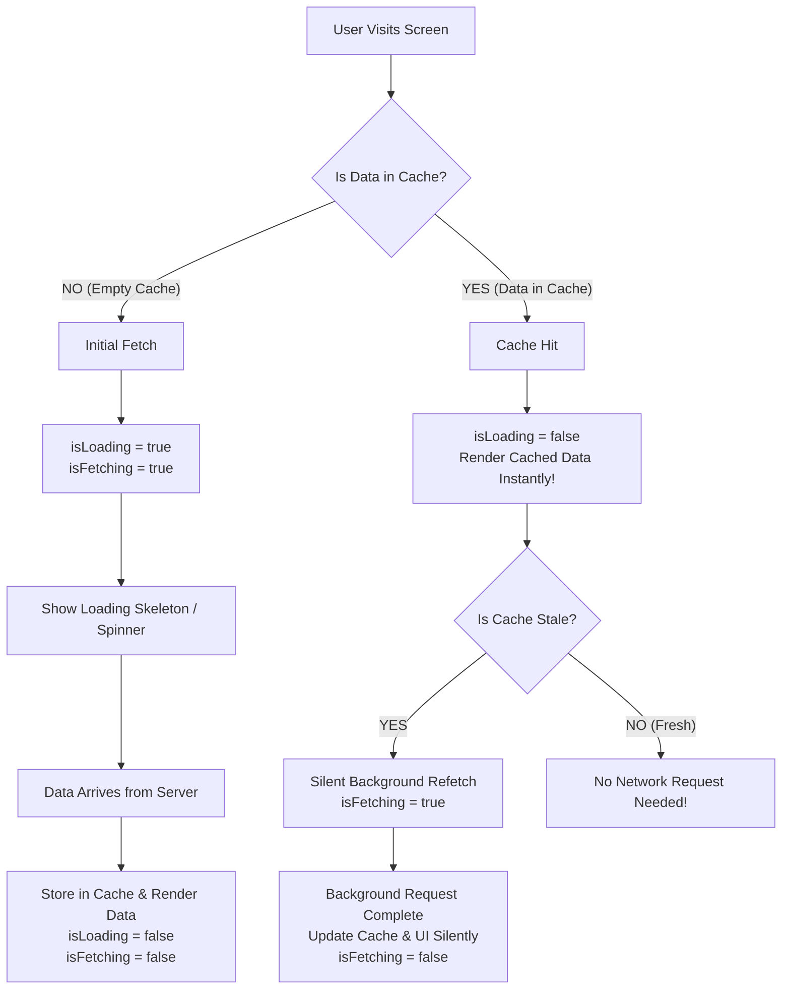
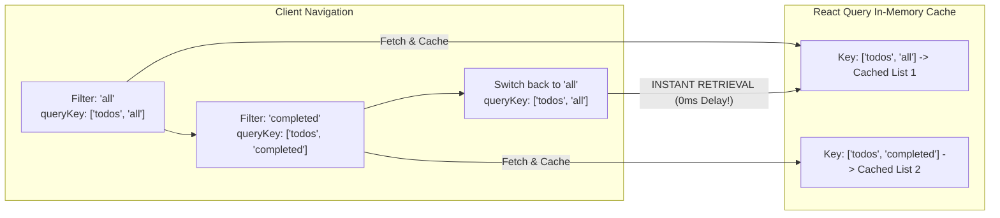
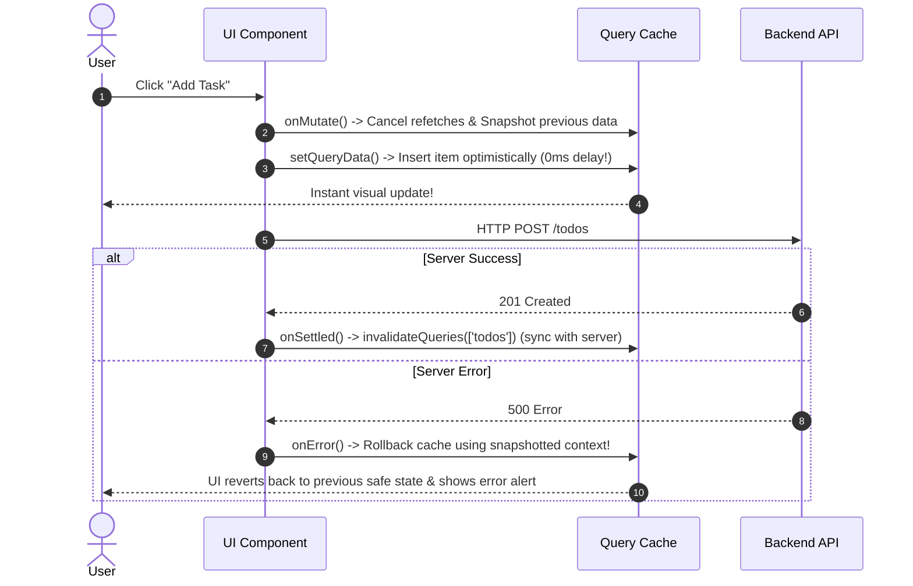

# State Management in React


 **React State Management** reference repository! This repository contains structured study notes, visual diagrams, and clean implementations designed for deep conceptual mastery and practical problem solving across modern React state management solutions, categorized into:
- **Client State**: Managing local synchronous application UI data (**Zustand**, **Redux Toolkit**, **Entity Adapter**).
- **Server State**: Managing asynchronous remote data fetching, caching, and synchronization (**TanStack React Query**, **RTK Query**).

> **Author:** Kamal Aboueid  
> **Topics:** State Management in React  
> **Client State:** Zustand • Redux Toolkit  
> **Server State:** TanStack React Query • RTK Query  
> **Status:** Active Learning & Hands-on Reference

---

# Zustand

Zustand is a fast, lightweight state management library for React. It provides a centralized store with a minimal API, zero boilerplate, and no need to wrap your app in Context Providers.


## Creating a Store & Updating State
Use `create` to define state values and action methods. Zustand provides `set` for state updates (merging shallowly by default, so you don't need to spread unmodified state).

```js
import { create } from "zustand";

const useStore = create((set) => ({
  count: 0,
  increment: () => set((state) => ({ count: state.count + 1 })),
  decrement: () => set((state) => ({ count: state.count - 1 })),
}));

export default useStore;
```

## Immer Middleware
Immer allows direct mutable updates (mutating drafts) while maintaining full immutability under the hood.

```js
import { create } from "zustand";
import { immer } from "zustand/middleware/immer";

export const useArray = create(
  immer((set) => ({
    todos: [],
    addTodo: (newTodo) =>
      set((state) => {
        state.todos.push(newTodo);
      }),
  }))
);
```

## Store Slice Pattern & Combining Slices
For larger applications, split stores into smaller feature slices and combine them into one bound store:

```js
// authSlice.js
export const createAuthSlice = (set) => ({
  user: null,
  login: (user) => set({ user }),
  logout: () => set({ user: null }),
});

// cartSlice.js
export const createCartSlice = (set) => ({
  cart: [],
  addToCart: (item) => set((state) => ({ cart: [...state.cart, item] })),
  removeFromCart: (item) => set((state) => ({ cart: state.cart.filter((i) => i !== item) })),
});

// store.js
import { create } from "zustand";
import { createAuthSlice } from "./authSlice";
import { createCartSlice } from "./cartSlice";

export const useBoundStore = create((...a) => ({
  ...createAuthSlice(...a),
  ...createCartSlice(...a),
}));
```

## Accessing Store Values & `useShallow`
Select only the values needed to avoid unnecessary re-renders. Use `useShallow` when selecting an object or array of multiple values.

```jsx
import { useBoundStore } from "./store";
import { useShallow } from "zustand/react/shallow";

function Header() {
  const { user, logout } = useBoundStore(
    useShallow((state) => ({
      user: state.user,
      logout: state.logout,
    }))
  );

  return (
    <header>
      {user ? <button onClick={logout}>Logout</button> : <span>Not logged in</span>}
    </header>
  );
}
```

## Persist Middleware
Saves store data in browser storage (`localStorage` by default) with support for partialize and versioning:

```js
import { create } from "zustand";
import { persist } from "zustand/middleware";

export const useAuthStore = create(
  persist(
    (set) => ({
      user: null,
      token: null,
      setAuth: (user, token) => set({ user, token }),
      logout: () => set({ user: null, token: null }),
    }),
    {
      name: "auth-storage",
      partialize: (state) => ({ user: state.user }),
      version: 1,
    }
  )
);
```

## `subscribeWithSelector` & Redux DevTools
- `subscribeWithSelector`: Listen to specific state changes outside React components (ideal for logging, analytics, sync).
- `devtools`: Enables inspection and time-travel debugging inside Redux DevTools.

```js
import { create } from "zustand";
import { devtools, persist, subscribeWithSelector } from "zustand/middleware";

export const useStore = create(
  devtools(
    persist(
      subscribeWithSelector((set) => ({
        count: 0,
        increment: () =>
          set((state) => ({ count: state.count + 1 }), false, "counter/increment"),
      })),
      { name: "counter-storage" }
    ),
    { name: "Counter Store" }
  )
);

// Subscribe to a specific field
useStore.subscribe(
  (state) => state.count,
  (current, prev) => console.log(`Count changed from ${prev} to ${current}`)
);
```

---

# Redux Toolkit (RTK) Notes


## 1. Redux Fundamentals
Redux manages shared global state through a predictable unidirectional flow:
**UI** → `dispatch(action)` → **Reducer** → **State Update** → **UI Re-render**

- **State:** The data stored in Redux (e.g., `{ count: 0, user: null }`).
- **Action:** An object describing what happened (`{ type: "counter/add", payload: 5 }`).
- **Reducer:** Pure function determining how state updates in response to actions.
- **Dispatch:** Triggers actions into the Redux store (`dispatch(increment())`).

## 2. Installation & Store Setup
```bash
npm install @reduxjs/toolkit react-redux
```

```jsx
// store.js
import { configureStore } from "@reduxjs/toolkit";
export const store = configureStore({ reducer: {} });

// main.jsx
import { Provider } from "react-redux";
import { store } from "./store";

<Provider store={store}>
  <App />
</Provider>
```

## 3. `createSlice`
Combines initial state, reducers, and auto-generated action creators in one place. RTK uses **Immer** internally, allowing you to write mutating syntax (`state.count += 1`) safely.

```js
// counterSlice.js
import { createSlice } from "@reduxjs/toolkit";

const counterSlice = createSlice({
  name: "counter",
  initialState: { count: 0 },
  reducers: {
    increment: (state) => { state.count += 1; },
    decrement: (state) => { state.count -= 1; },
  },
});

export const { increment, decrement } = counterSlice.actions;
export default counterSlice.reducer;
```

Mounting to store:
```js
export const store = configureStore({
  reducer: { counter: counterSlice.reducer }
});
```

## 4. React Hooks (`useSelector` & `useDispatch`)
- `useSelector`: Reads data from the store state.
- `useDispatch`: Dispatches action objects/creators.

```jsx
import { useSelector, useDispatch } from "react-redux";
import { increment, decrement } from "./counterSlice";

function Counter() {
  const count = useSelector((state) => state.counter.count);
  const dispatch = useDispatch();

  return (
    <div>
      <p>{count}</p>
      <button onClick={() => dispatch(increment())}>+</button>
      <button onClick={() => dispatch(decrement())}>-</button>
    </div>
  );
}
```

> **Data Flow:** Click Button → `dispatch(increment())` → Reducer runs → State updates → `useSelector` detects change → Component re-renders.

## 5. Selectors & `createSelector` (Memoization)
Selectors extract or compute **derived data** from state. Without memoization, functions like `.filter()` return a new reference on every run, triggering avoidable re-renders. `createSelector` memoizes results so calculations only re-run when inputs change.

```js
import { createSelector } from "@reduxjs/toolkit";

const selectTodos = (state) => state.todos.items;

export const selectCompletedTodos = createSelector(
  [selectTodos],
  (todos) => todos.filter((todo) => todo.completed)
);
```

```text
Without Memoization: State change anywhere → Selector recomputes → New Array Reference → Unnecessary re-renders
With createSelector: Same input state → Returns cached result → Prevents redundant re-renders
```

## 6. `createAsyncThunk`
Handles asynchronous logic (like HTTP requests). It automatically generates lifecycle actions: `pending`, `fulfilled`, and `rejected`.

```js
import { createSlice, createAsyncThunk } from "@reduxjs/toolkit";

export const fetchPosts = createAsyncThunk("posts/fetchPosts", async () => {
  const response = await fetch("https://api.example.com/posts");
  return await response.json();
});

const postsSlice = createSlice({
  name: "posts",
  initialState: { items: [], loading: false, error: null },
  reducers: {},
  extraReducers: (builder) => {
    builder
      .addCase(fetchPosts.pending, (state) => {
        state.loading = true;
        state.error = null;
      })
      .addCase(fetchPosts.fulfilled, (state, action) => {
        state.loading = false;
        state.items = action.payload;
      })
      .addCase(fetchPosts.rejected, (state, action) => {
        state.loading = false;
        state.error = action.error.message;
      });
  },
});
```

---

# RTK Query (Data Fetching & Caching)

RTK Query eliminates the need for manual `useEffect`, `useState`, and `createAsyncThunk` boilerplate for data fetching. It manages loading states, caching, deduplication, and automatic refetching out of the box.


### Complete Working Example

#### 1. API Slice (`store/apiSlice.js`)
```js
import { createApi, fetchBaseQuery } from "@reduxjs/toolkit/query/react";

export const apiSlice = createApi({
  reducerPath: "api",
  baseQuery: fetchBaseQuery({ baseUrl: "https://jsonplaceholder.typicode.com" }),
  tagTypes: ["Posts"],
  endpoints: (builder) => ({
    getPosts: builder.query({
      query: () => "/posts",
      providesTags: ["Posts"],
    }),
    addPost: builder.mutation({
      query: (newPost) => ({
        url: "/posts",
        method: "POST",
        body: newPost,
      }),
      invalidatesTags: ["Posts"],
    }),
  }),
});

export const { useGetPostsQuery, useAddPostMutation } = apiSlice;
```

#### 2. Configure Store (`store/store.js`)
```js
import { configureStore } from "@reduxjs/toolkit";
import { apiSlice } from "./apiSlice";

export const store = configureStore({
  reducer: {
    [apiSlice.reducerPath]: apiSlice.reducer,
  },
  middleware: (getDefaultMiddleware) =>
    getDefaultMiddleware().concat(apiSlice.middleware),
});
```

#### 3. Consuming Query & Mutation in Components
```jsx
// Posts.jsx
import { useGetPostsQuery } from "./store/apiSlice";

function Posts() {
  const { data, isLoading, error } = useGetPostsQuery();

  if (isLoading) return <h2>Loading...</h2>;
  if (error) return <h2>Error loading posts</h2>;

  return (
    <ul>
      {data?.slice(0, 10).map((post) => (
        <li key={post.id}>{post.title}</li>
      ))}
    </ul>
  );
}

// AddPost.jsx
import { useAddPostMutation } from "./store/apiSlice";

function AddPost() {
  const [addPost, { isLoading }] = useAddPostMutation();

  const handleAddPost = async () => {
    try {
      await addPost({ title: "Hello", body: "New Post Content", userId: 1 }).unwrap();
    } catch (err) {
      console.error("Failed to add post:", err);
    }
  };

  return (
    <button onClick={handleAddPost} disabled={isLoading}>
      {isLoading ? "Adding..." : "Add Post"}
    </button>
  );
}
```

> **Lifecycle Flow:** Component calls hook → `fetchBaseQuery` calls API → Result saved in RTK Query Cache → Component receives data → Mutation invalidates tag → Automatic re-fetch.

---

# Normalized State & Entity Adapter


## 1. The Core Problem: Why Do We Need Normalization?

When managing large collections of data (e.g. hundreds or thousands of users or posts) as standard flat arrays (`[{ id: 1 }, { id: 2 }, ...]`), two major problems arise:

1. **Performance Bottleneck ($O(N)$ Search Time):**
   - Finding, updating, or deleting an item requires looping through the array with `array.find()` or `array.filter()`.
   - On large datasets, this linear search takes **$O(N)$ time** and slows down the app.

2. **Update Complexity & Unnecessary Re-renders:**
   - In Redux, state is immutable. Modifying one single item in a flat array requires creating a new copy of the entire array.
   - This changes the reference of the whole list, triggering unnecessary re-renders across components even if their item didn't change.

---

## 2. The Solution: Normalized State Concept

**Normalized State** organizes unstructured lists into a clean two-part structure (similar to a database table):

1. **`ids` (Order Array):** An array of ID keys keeping the exact display order:
   ```json
   [1, 2, 3]
   ```
2. **`entities` (Lookup Dictionary):** An object map where each key is an ID and value is the full item data:
   ```json
   {
     "1": { "id": 1, "name": "Leanne Graham", "email": "sincere@april.biz" },
     "2": { "id": 2, "name": "Ervin Howell", "email": "shanna@melissa.tv" }
   }
   ```

> **Key Benefit:** Accessing, updating, or deleting any item is instant at **$O(1)$ time complexity** (`state.entities[id]`), without scanning through the array!

---

## 3. What is `createEntityAdapter`?

`createEntityAdapter` is an official utility provided by **Redux Toolkit** to manage normalized state with zero manual boilerplate.

### What it provides:
- **Standard Initial State:** Generates `{ ids: [], entities: {} }` plus your custom fields (e.g. `loading`, `error`).
- **Built-in CRUD Reducers:** Ready-to-use reducer methods for adding, updating, and removing items.
- **Automatic Sorting:** Keeps the `ids` array sorted at all times using `sortComparer`.
- **Pre-generated Memoized Selectors:** High-performance selectors (`selectAll`, `selectById`, etc.) ready for `useSelector`.

```mermaid
flowchart LR
    subgraph Reducers["CRUD Reducers (Write)"]
        direction TB
        R1["setAll / setMany"]
        R2["addOne / addMany"]
        R3["updateOne / updateMany"]
        R4["upsertOne / upsertMany"]
        R5["removeOne / removeAll"]
    end

    subgraph State["Normalized Store"]
        direction TB
        ID["ids: [1, 2, 3] (Sorted Order)"]
        ENT["entities: { 1: {...}, 2: {...} } (O(1) Map)"]
    end

    subgraph Selectors["Memoized Selectors (Read)"]
        direction TB
        S1["selectAll -> Sorted Array for UI"]
        S2["selectById -> O(1) Direct Lookup"]
        S3["selectIds -> Array of IDs"]
        S4["selectEntities -> Dictionary Map"]
        S5["selectTotal -> Total Items Count"]
    end

    Reducers -->|Mutate & Sort| State
    State -->|Extract & Memoize| Selectors
```



---

## 4. Built-in CRUD Methods Reference

All adapter methods can be used directly as slice reducers or inside `extraReducers`:

| Method | Behavior (Simple English) | Time Complexity |
| :--- | :--- | :---: |
| `setAll(state, items)` | Clears all existing items and loads a new list in sorted, normalized shape. | $O(N \log N)$ |
| `setOne(state, item)` | Adds a new item or completely replaces it if it already exists. | $O(1)$ |
| `setMany(state, items)` | Adds or completely replaces multiple items. | $O(K)$ |
| `addOne(state, item)` | Adds a single new item. Does nothing if the ID already exists. | $O(1)$ |
| `addMany(state, items)` | Adds multiple new items at once. | $O(K)$ |
| `updateOne(state, { id, changes })` | Updates specific fields of an existing item using `{ id, changes }`. | $O(1)$ |
| `updateMany(state, updates)` | Updates specific fields of multiple existing items. | $O(K)$ |
| `upsertOne(state, item)` | Smart insert: adds the item if new, or merges updates if it already exists. | $O(1)$ |
| `upsertMany(state, items)` | Smart insert or update for multiple items at once. | $O(K)$ |
| `removeOne(state, id)` | Deletes a single item by its ID. | $O(1)$ |
| `removeMany(state, [ids])` | Deletes multiple items by their IDs. | $O(K)$ |
| `removeAll(state)` | Empties the entire store (clears `ids` and `entities`). | $O(1)$ |

---

## 5. Built-in Memoized Selectors Reference

Calling `adapter.getSelectors((state) => state.feature)` generates optimized memoized selectors:

| Selector | Return Value | Common Use Case |
| :--- | :--- | :--- |
| `selectAll` | Array of all entity objects in sorted order. | Rendering lists in UI with `.map()`. |
| `selectById` | Single item object matching given ID, or `undefined`. | Detail view / profile card for one user. |
| `selectIds` | Array of all IDs (`[1, 2, 3]`). | Checking item existence or ID-only rendering. |
| `selectEntities` | Dictionary object (`{ [id]: entity }`). | Fast lookups in custom selectors. |
| `selectTotal` | Total number of items stored. | Showing badge counts (e.g. "Total Users: 10"). |

---

## 6. Complete Practical Example (`Entity.js`)

Here is the complete implementation matching [`src/store/Entity.js`](file:///d:/directState/src/store/Entity.js):

```javascript
// src/store/Entity.js
import { createSlice, createEntityAdapter, createAsyncThunk } from '@reduxjs/toolkit';
import axios from 'axios';

// 1. Create the adapter with auto-sorting by name
const AllPosts = createEntityAdapter({
  sortComparer: (a, b) => a.name.localeCompare(b.name), // Automatic sorting based on name
});

// 2. Generate initial state with custom flags (loading, error)
const initialState = AllPosts.getInitialState({
  loading: false,
  error: null,
});

// 3. Async Thunk to fetch data from API
export const fetchUser = createAsyncThunk("user/fetchUser", async () => {
  const response = await axios.get("https://jsonplaceholder.typicode.com/users");
  return response.data;
});

// 4. Create Slice using built-in adapter methods
export const AllPostsSlice = createSlice({
  name: 'AllPosts',
  initialState,
  reducers: {
    // Adapter Built-in Methods maintain sorted order automatically
    addOne: AllPosts.addOne,
    addMany: AllPosts.addMany,
    updateOne: AllPosts.updateOne,
    removeOne: AllPosts.removeOne,
    removeAll: AllPosts.removeAll,
  },
  extraReducers: (builder) => {
    builder
      .addCase(fetchUser.pending, (state) => {
        state.loading = true;
        state.error = null;
      })
      .addCase(fetchUser.fulfilled, (state, action) => {
        state.loading = false;
        // setAll normalizes and sorts all items automatically
        AllPosts.setAll(state, action.payload);
      })
      .addCase(fetchUser.rejected, (state) => {
        state.loading = false;
        state.error = "Something Went Wrong";
      });
  },
});

export const { addOne, addMany, updateOne, removeOne, removeAll } = AllPostsSlice.actions;
export default AllPostsSlice.reducer;

// 5. Adapter Built-in Selectors
export const {
  selectAll: selectAllPosts,   // returns all posts in sorted array
  selectById: selectPostById,  // returns post by id in O(1)
  selectIds: selectPostIds,    // returns all ids
} = AllPosts.getSelectors((state) => state.AllPosts);
```

### Component Usage Example

```jsx
import React, { useEffect } from 'react';
import { useSelector, useDispatch } from 'react-redux';
import { 
  fetchUser, 
  selectAllPosts, 
  selectPostById, 
  removeOne, 
  updateOne 
} from './store/Entity';

function UsersComponent() {
  const dispatch = useDispatch();
  const users = useSelector(selectAllPosts);
  const { loading, error } = useSelector((state) => state.AllPosts);

  useEffect(() => {
    dispatch(fetchUser());
  }, [dispatch]);

  if (loading) return <h2>Loading...</h2>;
  if (error) return <h2>{error}</h2>;

  return (
    <div>
      <h2>Users List (Sorted by Name)</h2>
      <ul>
        {users.map((user) => (
          <li key={user.id}>
            <strong>{user.name}</strong> — {user.email}
            <button onClick={() => dispatch(removeOne(user.id))}>Delete</button>
            <button onClick={() => dispatch(updateOne({ id: user.id, changes: { name: `${user.name} (Updated)` } }))}>
              Update
            </button>
          </li>
        ))}
      </ul>
    </div>
  );
}

export default UsersComponent;
```

---

# Redux Toolkit — Project Architecture

Organize your project by **features** rather than technical layers. Each feature owns its slice, selectors, and API endpoints.

```text
src/
├── app/
│   └── store.js              # Central Redux store configuration
├── services/
│   └── api.js                # Base RTK Query service (baseUrl, tagTypes)
├── features/
│   ├── auth/
│   │   ├── authSlice.js
│   │   └── authApi.js
│   ├── courses/
│   │   ├── coursesSlice.js
│   │   └── coursesApi.js     # Injected endpoints for courses
│   └── users/
│       ├── usersSlice.js
│       └── usersApi.js       # Injected endpoints for users
└── components/
```

### 1. Base API & Code-Splitting (`injectEndpoints`)
Instead of multiple API instances, create one empty base API and let each feature inject its own endpoints:

```js
// services/api.js
import { createApi, fetchBaseQuery } from "@reduxjs/toolkit/query/react";

export const api = createApi({
  reducerPath: "api",
  baseQuery: fetchBaseQuery({ baseUrl: "/api" }),
  tagTypes: ["Courses", "Users", "Auth"],
  endpoints: () => ({}),
});
```

```js
// features/courses/coursesApi.js
import { api } from "../../services/api";

export const coursesApi = api.injectEndpoints({
  endpoints: (builder) => ({
    getCourses: builder.query({
      query: () => "/courses",
      providesTags: ["Courses"],
    }),
    addCourse: builder.mutation({
      query: (course) => ({
        url: "/courses",
        method: "POST",
        body: course,
      }),
      invalidatesTags: ["Courses"],
    }),
  }),
});

export const { useGetCoursesQuery, useAddCourseMutation } = coursesApi;
```

### 2. Central Store Combining Features & Injected API
```js
// app/store.js
import { configureStore } from "@reduxjs/toolkit";
import { api } from "../services/api";
import authReducer from "../features/auth/authSlice";
import coursesReducer from "../features/courses/coursesSlice";

export const store = configureStore({
  reducer: {
    auth: authReducer,
    courses: coursesReducer,
    [api.reducerPath]: api.reducer,
  },
  middleware: (getDefaultMiddleware) =>
    getDefaultMiddleware().concat(api.middleware),
});
```

> **Key Rule:** Features own their domain logic (`Slice` + `Selectors` + `Endpoints`), while `store.js` and `api.js` act as the glue combining them.

---

# TanStack React Query

**TanStack Query (React Query)** is a powerful server-state management library for React. It manages asynchronous server data, caching, background synchronization, deduplication, and loading/error states with minimal code.



---

## 1. Setup & Configuration

### `queryClient.js`
Define a centralized `QueryClient` instance to set default behaviors across all queries:

```js
import { QueryClient } from "@tanstack/react-query";

export const queryClient = new QueryClient({
  defaultOptions: {
    queries: {
      staleTime: 1000 * 60 * 5,    // Data remains fresh for 5 minutes (no background refetch during this time)
      gcTime: 1000 * 60 * 10,      // Unused cache stays in memory for 10 minutes before Garbage Collection
      refetchOnWindowFocus: false, // Prevents automatic refetch when the user refocuses the browser window
      retry: 3,                    // Automatically retries failed queries up to 3 times
    },
  },
});
```

### Wrapping the Application (`main.jsx`)
Wrap the React root with `QueryClientProvider` and activate `ReactQueryDevtools`:

```jsx
import { StrictMode } from "react";
import { createRoot } from "react-dom/client";
import { QueryClientProvider } from "@tanstack/react-query";
import { ReactQueryDevtools } from "@tanstack/react-query-devtools";
import { queryClient } from "./react-query/queryClient.js";
import App from "./App.jsx";

createRoot(document.getElementById("root")).render(
  <StrictMode>
    <QueryClientProvider client={queryClient}>
      <App />
      <ReactQueryDevtools initialIsOpen={false} />
    </QueryClientProvider>
  </StrictMode>
);
```

---

## 2. Advanced `useQuery` Anatomy (Fetching & Reading Data)

The `useQuery` hook manages reading, caching, and auto-syncing remote data.

```js
const {
  data: todos,
  isLoading,
  isError,
  error,
  isFetching,
  isStale,
  status,
  fetchStatus,
  refetch,
  dataUpdatedAt,
} = useQuery({
  queryKey: ["todos", filter],
  queryFn: fetchTodos,
  staleTime: 1000 * 60 * 2,    // 2 minutes fresh
  gcTime: 1000 * 60 * 10,      // 10 minutes cache retention
  refetchOnWindowFocus: true,  // Auto refetch on tab focus
  retry: 3,                    // Retry 3 times on failure
  retryDelay: (attempt) => Math.min(1000 * 2 ** attempt, 30000), // Exponential backoff
  select: (data) => data.map(todo => ({ ...todo, titleUpper: todo.title.toUpperCase() })),
});
```

### Advanced `useQuery` Options Explained

| Option | What it does | Simple Example |
|---|---|---|
| **`queryKey`** | The unique identifier for this cache entry in memory. Accepts an array with dynamic parameters. | `['todos', filter]` |
| **`queryFn`** | The async function that fetches data. It automatically receives `{ queryKey }`. | `fetchTodos({ queryKey })` |
| **`staleTime`** | How long (in ms) the data is considered **fresh**. While fresh, React Query returns cached data without calling the server. | `1000 * 60 * 2` (2 mins) |
| **`gcTime`** | (Formerly `cacheTime`). How long inactive/unused data stays in memory before being garbage collected. | `1000 * 60 * 10` (10 mins) |
| **`refetchOnWindowFocus`** | When `true`, refetches fresh data when the user switches tabs and comes back. | `true` |
| **`retry`** | Number of times to retry a failed request before showing an error. | `3` |
| **`retryDelay`** | Delay between retries. Can use exponential backoff formula. | `(attempt) => Math.min(1000 * 2 ** attempt, 30000)` |
| **`select`** | Transforms or filters the data before the component receives it. Saves unnecessary re-renders. | `(data) => data.map(...)` |

### `staleTime` vs `gcTime` Timeline



---

## 3. Query Return Properties & States

### `isLoading` vs `isFetching`



### `status` vs `fetchStatus`
In TanStack Query v5, states are separated into two distinct dimensions:
- **`status`**: Represents the **data availability**:
  - `'pending'`: No data is available yet.
  - `'error'`: An error happened.
  - `'success'`: Data was fetched successfully.
- **`fetchStatus`**: Represents the **network activity**:
  - `'fetching'`: An active HTTP request is in progress.
  - `'paused'`: The query wanted to fetch, but there is no internet connection.
  - `'idle'`: No network request is running right now.

### Other Useful Properties
- **`isStale`**: Boolean flag showing if the data has exceeded its `staleTime`.
- **`dataUpdatedAt`**: Timestamp (number in ms) of when the data was last successfully fetched. Use `new Date(dataUpdatedAt).toLocaleTimeString()` to show the user the last updated time!
- **`refetch`**: Manual trigger function to force a refetch on demand (e.g. Refresh button).

---

## 4. Global Monitoring Hooks

TanStack Query provides global monitoring hooks to track activity across the entire application:

```js
import { useIsFetching, useIsMutating } from "@tanstack/react-query";

// 1. Returns number of queries currently fetching anywhere in the app
const globalIsFetchingCount = useIsFetching();

// 2. Returns number of mutations currently executing anywhere in the app
const globalIsMutatingCount = useIsMutating();
```

> **Use Case:** Perfect for displaying global loading spinners, status badges, or network sync bars in your application header.

---

## 5. The Power of `queryKey` & Parameters

The `queryKey` is the unique cache identifier:



### Accessing `queryKey` inside `queryFn`:
You can read parameters directly from `queryKey` inside `queryFn`:

```js
const fetchTodos = async ({ queryKey }) => {
  const [, filter] = queryKey; // Extracts 'filter' parameter
  const response = await axios.get("https://jsonplaceholder.typicode.com/todos", {
    params: {
      _limit: 5,
      completed: filter === "completed" ? true : filter === "active" ? false : undefined,
    },
  });
  return response.data;
};
```

---

## 6. `useMutation` (Creating, Updating & Deleting Data)

While `useQuery` is for **reading data**, `useMutation` is for **writing data and side effects** (POST, PUT, PATCH, DELETE).

### Core Anatomy of `useMutation`

```js
const mutation = useMutation({
  mutationFn: async (newTodo) => {
    return await axios.post("/api/todos", newTodo);
  },
  onMutate: async (variables) => {
    // 1. Runs BEFORE mutation executes (used for Optimistic Updates)
  },
  onError: (error, variables, context) => {
    // 2. Runs if mutation fails (rollback local cache)
  },
  onSuccess: (data, variables, context) => {
    // 3. Runs on server success
  },
  onSettled: (data, error, variables, context) => {
    // 4. Runs ALWAYS on finish (like 'finally') -> Invalidate queries!
  },
});
```

---

## 7. Deep Dive: Optimistic Updates with Rollback

**Optimistic Updates** make your app feel instant. You update the local UI cache immediately before waiting for the server response. If the server request fails, you roll back to the previous snapshot!



### 3 Practical Mutation Patterns:

### Pattern A: Add Item (POST) with Optimistic Update & Rollback
```js
const addMutation = useMutation({
  mutationFn: (newTodo) => axios.post("/api/todos", newTodo),

  // Step 1: Optimistic Update before request
  onMutate: async (newTodoVariables) => {
    await queryClient.cancelQueries({ queryKey: ["todos", filter] });
    const previousTodos = queryClient.getQueryData(["todos", filter]);

    // Optimistically update cache with temporary ID
    queryClient.setQueryData(["todos", filter], (old = []) => [
      { id: Date.now(), title: newTodoVariables.title, completed: false },
      ...old,
    ]);

    // Return context with snapshot for rollback
    return { previousTodos };
  },

  // Step 2: Rollback on error
  onError: (err, newTodo, context) => {
    queryClient.setQueryData(["todos", filter], context.previousTodos);
    console.error("Mutation failed, rolled back:", err.message);
  },

  // Step 3: Always re-sync with server
  onSettled: () => {
    queryClient.invalidateQueries({ queryKey: ["todos"] });
  },

  onSuccess: () => {
    setNewTitle("");
  },
});
```

### Pattern B: Update Item (PUT / PATCH)
```js
const updateMutation = useMutation({
  mutationFn: (updatedTodo) =>
    axios.put(`/api/todos/${updatedTodo.id}`, updatedTodo),
  onSuccess: () => {
    // Invalidate query to trigger automatic background refetch
    queryClient.invalidateQueries({ queryKey: ["todos"] });
  },
});
```

### Pattern C: Delete Item (DELETE) with Optimistic Removal
```js
const deleteMutation = useMutation({
  mutationFn: (id) => axios.delete(`/api/todos/${id}`),

  onMutate: async (deletedId) => {
    await queryClient.cancelQueries({ queryKey: ["todos", filter] });
    const previousTodos = queryClient.getQueryData(["todos", filter]);

    // Immediately remove item from local cache
    queryClient.setQueryData(["todos", filter], (old = []) =>
      old.filter((todo) => todo.id !== deletedId)
    );

    return { previousTodos };
  },

  onError: (err, deletedId, context) => {
    // Revert deletion if server request fails
    queryClient.setQueryData(["todos", filter], context.previousTodos);
  },

  onSettled: () => {
    queryClient.invalidateQueries({ queryKey: ["todos"] });
  },
});
```

---

## 8. Triggering Mutations (`mutate` vs `mutateAsync`)

| Method | Return Type | Usage Scenario |
|---|---|---|
| **`mutate(variables)`** | `void` | Standard trigger. Handles success/error inside options callbacks. |
| **`mutateAsync(variables)`** | `Promise` | Returns a Promise. Use when you need `try/catch` or need to `await` the result inside an async event handler. |

---

## 9. Complete Working Component (`useMutationExampple.jsx`)

Here is the complete reference implementation demonstrating `useQuery`, `useMutation`, Optimistic Updates, filters, and global monitoring in one cohesive component:

```jsx
import { useState } from 'react';
import { 
    useQuery, 
    useMutation, 
    useQueryClient, 
    useIsFetching, 
    useIsMutating 
} from '@tanstack/react-query';
import axios from 'axios';

const fetchTodos = async ({ queryKey }) => {
    const [, filter] = queryKey;
    const response = await axios.get('https://jsonplaceholder.typicode.com/todos', {
        params: { _limit: 5, completed: filter === 'completed' ? true : filter === 'active' ? false : undefined }
    });
    return response.data;
};

const addTodoItem = async (newTodo) => {
    const response = await axios.post('https://jsonplaceholder.typicode.com/todos', newTodo);
    return response.data;
};

const updateTodoItem = async (updatedTodo) => {
    const response = await axios.put(`https://jsonplaceholder.typicode.com/todos/${updatedTodo.id}`, updatedTodo);
    return response.data;
};

const deleteTodoItem = async (id) => {
    await axios.delete(`https://jsonplaceholder.typicode.com/todos/${id}`);
    return id;
};

export default function CompleteReactQueryComponent() {
    const [filter, setFilter] = useState('all');
    const [newTitle, setNewTitle] = useState('');
    const queryClient = useQueryClient();

    // Global monitoring hooks
    const globalIsFetchingCount = useIsFetching();
    const globalIsMutatingCount = useIsMutating();

    // useQuery with advanced options
    const {
        data: todos,
        isLoading,
        isError,
        error,
        isFetching,
        isStale,
        status,
        fetchStatus,
        refetch,
        dataUpdatedAt
    } = useQuery({
        queryKey: ['todos', filter],
        queryFn: fetchTodos,
        staleTime: 1000 * 60 * 2,
        gcTime: 1000 * 60 * 10,
        refetchOnWindowFocus: true,
        retry: 3,
        retryDelay: (attemptIndex) => Math.min(1000 * 2 ** attemptIndex, 30000),
        select: (data) => data.map(todo => ({ ...todo, titleUppercase: todo.title.toUpperCase() }))
    });

    // useMutation: Add Item (POST) with Optimistic Update
    const addMutation = useMutation({
        mutationFn: addTodoItem,
        onMutate: async (newTodoVariables) => {
            await queryClient.cancelQueries({ queryKey: ['todos', filter] });
            const previousTodos = queryClient.getQueryData(['todos', filter]);

            queryClient.setQueryData(['todos', filter], (old = []) => [
                { id: Date.now(), title: newTodoVariables.title, completed: false, titleUppercase: newTodoVariables.title.toUpperCase() },
                ...old,
            ]);

            return { previousTodos };
        },
        onError: (err, newTodo, context) => {
            queryClient.setQueryData(['todos', filter], context.previousTodos);
            console.error('Mutation failed, rolled back:', err.message);
        },
        onSettled: () => {
            queryClient.invalidateQueries({ queryKey: ['todos'] });
        },
        onSuccess: () => {
            setNewTitle('');
        }
    });

    // useMutation: Update Item (PUT)
    const updateMutation = useMutation({
        mutationFn: updateTodoItem,
        onSuccess: () => {
            queryClient.invalidateQueries({ queryKey: ['todos'] });
        }
    });

    // useMutation: Delete Item (DELETE) with Optimistic Removal
    const deleteMutation = useMutation({
        mutationFn: deleteTodoItem,
        onMutate: async (deletedId) => {
            await queryClient.cancelQueries({ queryKey: ['todos', filter] });
            const previousTodos = queryClient.getQueryData(['todos', filter]);

            queryClient.setQueryData(['todos', filter], (old = []) => 
                old.filter(todo => todo.id !== deletedId)
            );

            return { previousTodos };
        },
        onError: (err, deletedId, context) => {
            queryClient.setQueryData(['todos', filter], context.previousTodos);
        },
        onSettled: () => {
            queryClient.invalidateQueries({ queryKey: ['todos'] });
        }
    });

    const handleAddSubmit = (e) => {
        e.preventDefault();
        if (!newTitle.trim()) return;
        addMutation.mutate({ title: newTitle, completed: false, userId: 1 });
    };

    const handleToggleComplete = (todo) => {
        updateMutation.mutate({ ...todo, completed: !todo.completed });
    };

    if (isLoading) return <div style={{ padding: '20px' }}>Loading initial data...</div>;
    if (isError) return <div style={{ padding: '20px', color: 'red' }}>Error: {error.message}</div>;

    return (
        <div style={{ padding: '30px', fontFamily: 'Arial, sans-serif', maxWidth: '600px', margin: '0 auto' }}>
            <h2>Advanced Complete React Query Demonstration</h2>

            {/* Global Monitoring Indicators */}
            <div style={{ background: '#f0f0f0', padding: '10px', marginBottom: '15px', borderRadius: '5px', fontSize: '14px' }}>
                <p>Global Active Queries Fetching: <strong>{globalIsFetchingCount}</strong></p>
                <p>Global Active Mutations Running: <strong>{globalIsMutatingCount}</strong></p>
            </div>

            {/* Query Status & Metadata panel */}
            <div style={{ background: '#eef2f7', padding: '10px', marginBottom: '15px', borderRadius: '5px', fontSize: '13px' }}>
                <p>Query Status: <code>{status}</code> | Fetch Status: <code>{fetchStatus}</code></p>
                <p>Is Data Stale? <strong>{isStale ? 'Yes' : 'No'}</strong> | Background Refetching: <strong>{isFetching ? 'Yes' : 'No'}</strong></p>
                <p>Last Data Update Time: {new Date(dataUpdatedAt).toLocaleTimeString()}</p>
                <button onClick={() => refetch()} style={{ marginTop: '5px', padding: '4px 8px' }}>Manual Refetch</button>
            </div>

            {/* Filters Navigation */}
            <div style={{ marginBottom: '15px', display: 'flex', gap: '10px' }}>
                <button onClick={() => setFilter('all')} style={{ fontWeight: filter === 'all' ? 'bold' : 'normal' }}>All</button>
                <button onClick={() => setFilter('active')} style={{ fontWeight: filter === 'active' ? 'bold' : 'normal' }}>Active</button>
                <button onClick={() => setFilter('completed')} style={{ fontWeight: filter === 'completed' ? 'bold' : 'normal' }}>Completed</button>
            </div>

            {/* Add Todo Form */}
            <form onSubmit={handleAddSubmit} style={{ marginBottom: '20px', display: 'flex', gap: '10px' }}>
                <input 
                    type="text" 
                    placeholder="Enter new task..." 
                    value={newTitle}
                    onChange={(e) => setNewTitle(e.target.value)}
                    style={{ flex: 1, padding: '8px' }}
                />
                <button type="submit" disabled={addMutation.isPending} style={{ padding: '8px 15px' }}>
                    {addMutation.isPending ? 'Adding...' : 'Add Task'}
                </button>
            </form>

            {/* Todos List Display */}
            <ul style={{ listStyle: 'none', padding: 0 }}>
                {todos?.map(todo => (
                    <li 
                        key={todo.id} 
                        style={{ 
                            display: 'flex', 
                            justifyContent: 'space-between', 
                            alignItems: 'center', 
                            padding: '10px', 
                            borderBottom: '1px solid #ddd',
                            background: todo.completed ? '#e8f5e9' : '#fff'
                        }}
                    >
                        <span 
                            onClick={() => handleToggleComplete(todo)}
                            style={{ 
                                textDecoration: todo.completed ? 'line-through' : 'none', 
                                cursor: 'pointer',
                                flex: 1 
                            }}
                        >
                            {todo.titleUppercase}
                        </span>
                        
                        <button 
                            onClick={() => deleteMutation.mutate(todo.id)}
                            disabled={deleteMutation.isPending}
                            style={{ background: '#ff5252', color: '#fff', border: 'none', padding: '5px 10px', cursor: 'pointer', borderRadius: '3px' }}
                        >
                            Delete
                        </button>
                    </li>
                ))}
            </ul>
        </div>
    );
}
```
