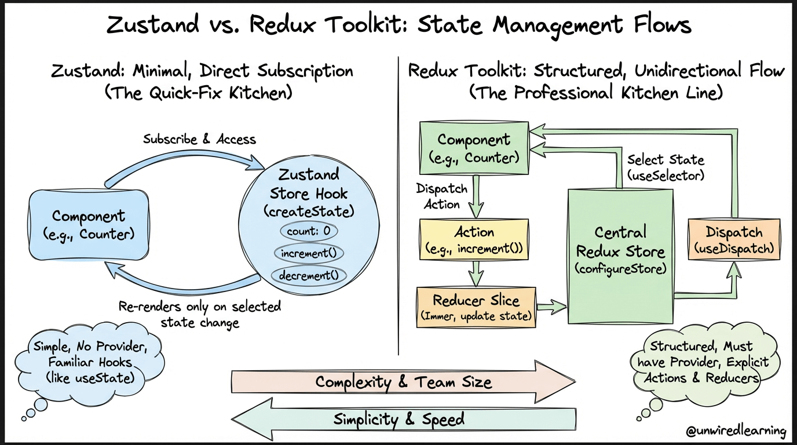
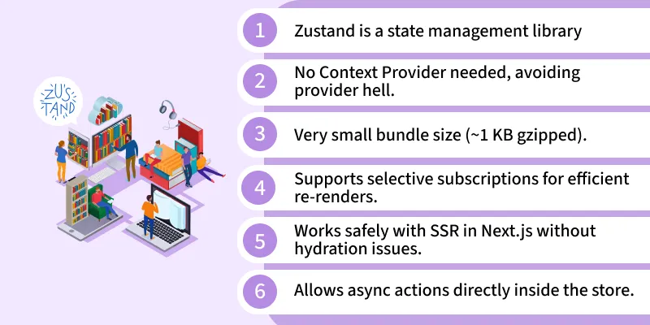

# DirectState-_Management-
Zustand , Redux , Jotai ,Valito , annd more....

# Zustand

Zustand is a small and simple state management library for React.
It helps us create a global store with state and actions.
It has a simple API and needs less code than many other state libraries.

 
 
 
 

## Creating a Store

We use `create` to create a Zustand store.
The store can contain state values and actions.
The `set` function is used to update the state.

```js
import { create } from "zustand";

const useStore = create((set) => ({
  count: 0,

  increment: () =>
    set((state) => ({
      count: state.count + 1,
    })),

  decrement: () =>
    set((state) => ({
      count: state.count - 1,
    })),
}));

export default useStore;
```

## Updating State

Zustand updates the state by using the `set` function.
We do not need to copy the whole store manually.
Only the values returned from `set` will be updated.

```js
const useStore = create((set) => ({
  count: 0,

  increment: () =>
    set((state) => ({
      count: state.count + 1,
    })),
}));
```

## Immer Middleware

Immer makes it easier to update complex state.
We can write state updates like normal JavaScript code.
Immer keeps the state immutable for us.

```js
import { create } from "zustand";
import { immer } from "zustand/middleware/immer";

export const useArray = create(
  immer((set) => ({
    todos: [],

    addTodo: (newTodo) =>
      set((state) => {
        state.todos.push(newTodo);
      }),
  }))
);
```

## Store Slice Pattern

The Slice Pattern helps us split a large store into smaller parts.
Each slice can contain its own state and actions.
For example, we can create an Auth slice and a Cart slice.

```js
export const createAuthSlice = (set) => ({
  user: null,

  login: (user) =>
    set({
      user,
    }),

  logout: () =>
    set({
      user: null,
    }),
});

export const createCartSlice = (set) => ({
  cart: [],

  addToCart: (item) =>
    set((state) => ({
      cart: [...state.cart, item],
    })),

  removeFromCart: (item) =>
    set((state) => ({
      cart: state.cart.filter((i) => i !== item),
    })),
});
```

## Combining Slices

We can combine multiple slices into one Zustand store.
This keeps the code organized when the application becomes larger.
The final store contains the state and actions from all slices.

```js
import { create } from "zustand";
import { createAuthSlice } from "./authSlice";
import { createCartSlice } from "./cartSlice";

export const useBoundStore = create((...a) => ({
  ...createAuthSlice(...a),
  ...createCartSlice(...a),
}));
```

## Accessing Store Values

We can access store values and actions using the store hook.
A selector lets us choose only the value we need.
This can help avoid unnecessary component updates.

```js
function Header() {
  const user = useBoundStore((state) => state.user);
  const logout = useBoundStore((state) => state.logout);

  return (
    <header>
      {user ? (
        <button onClick={logout}>Logout</button>
      ) : (
        <span>Not logged in</span>
      )}
    </header>
  );
}
```

## useShallow

`useShallow` is useful when we need multiple values from the store.
It compares the selected values and can help avoid unnecessary re-renders.
It is useful when selecting several related values together.

```js
import { useShallow } from "zustand/react/shallow";

const { cart, addToCart } = useBoundStore(
  useShallow((state) => ({
    cart: state.cart,
    addToCart: state.addToCart,
  }))
);
```

## Persist Middleware

The `persist` middleware saves store data in browser storage.
It can use `localStorage` by default.
We can also choose which parts of the state should be saved.

```js
import { create } from "zustand";
import { persist } from "zustand/middleware";

export const useAuthStore = create(
  persist(
    (set) => ({
      user: null,
      token: null,

      setAuth: (user, token) =>
        set({
          user,
          token,
        }),

      logout: () =>
        set({
          user: null,
          token: null,
        }),
    }),
    {
      name: "auth-storage",

      partialize: (state) => ({
        user: state.user,
      }),

      version: 1,
    }
  )
);
```

## subscribeWithSelector

`subscribeWithSelector` lets us watch a specific value in the store.
The callback runs when the selected value changes.
It can be useful for analytics or logic outside React components.

```js
import { create } from "zustand";
import { subscribeWithSelector } from "zustand/middleware";

export const useStore = create(
  subscribeWithSelector((set) => ({
    count: 0,

    increment: () =>
      set((state) => ({
        count: state.count + 1,
      })),
  }))
);

useStore.subscribe(
  (state) => state.count,
  (currentCount, previousCount) => {
    console.log(
      `Counter changed from ${previousCount} to ${currentCount}`
    );
  }
);
```

## Redux DevTools

Zustand can work with Redux DevTools for debugging.
It lets us see state changes and actions while developing.
It also supports time travel between previous states.

```js
import { create } from "zustand";
import { devtools } from "zustand/middleware";

export const useStore = create(
  devtools(
    (set) => ({
      count: 0,

      increment: () =>
        set(
          (state) => ({
            count: state.count + 1,
          }),
          false,
          "counter/increment"
        ),
    }),
    {
      name: "Awesome Store",
    }
  )
);
```

## Middleware

Zustand middleware adds extra features to a store.
For example, `persist` saves state, `devtools` helps with debugging,
and `subscribeWithSelector` lets us listen to specific state changes.

```js
import { create } from "zustand";
import {
  devtools,
  persist,
  subscribeWithSelector,
} from "zustand/middleware";

const useStore = create(
  devtools(
    persist(
      subscribeWithSelector((set) => ({
        count: 0,

        increment: () =>
          set((state) => ({
            count: state.count + 1,
          })),
      })),
      {
        name: "counter-storage",
      }
    ),
    {
      name: "Counter Store",
    }
  )
);
```
# Redux Toolkit Notes
## 1. Redux Fundamentals
Redux is a state management library.
It helps us manage shared data in one central store.
The main idea is:
UI → Dispatch Action → Reducer → Update State → UI
### State
State is the data stored inside Redux.
Example:
    const initialState = {
      count: 0,
      user: null
    };
Here, `count` and `user` are part of the state.
### Action
An action tells Redux what happened.
Example:
    {
      type: "counter/increment"
    }
An action can also send data using `payload`.
    {
      type: "counter/add",
      payload: 5
    }
### Reducer
A reducer is a function that decides how the state changes.
    const counterReducer = (state, action) => {
      if (action.type === "counter/increment") {
        return {
          ...state,
          count: state.count + 1
        };
      }
      return state;
    };

### Dispatch

`dispatch` sends an action to Redux.
    dispatch({
      type: "counter/increment"
    });
The action goes to the reducer.
The reducer updates the state.
Then React gets the new state.
---
## 2. Installation & Setup
For a React project, install these packages:
    npm install @reduxjs/toolkit react-redux
`@reduxjs/toolkit` gives us the tools to build Redux applications.
`react-redux` connects Redux with React.
### Create the Store
The Store is the central place that contains our Redux state.
    import { configureStore } from "@reduxjs/toolkit";
    export const store = configureStore({
      reducer: {}
    });
### Provider
We use `Provider` to make the Store available to React components.
    import { Provider } from "react-redux";
    import { store } from "./store";

    <Provider store={store}>
      <App />
    </Provider>

Now all components inside `Provider` can access the Redux Store.
---
## 3. createSlice & Store
`createSlice` is one of the most important tools in Redux Toolkit.
It puts the state, reducers, and actions together in one place.
### Example
    import { createSlice } from "@reduxjs/toolkit";
    const counterSlice = createSlice({
      name: "counter",
      initialState: {
        count: 0
      },
      reducers: {
        increment: (state) => {
          state.count += 1;
        },

        decrement: (state) => {
          state.count -= 1;
        }
      }
    });
    export const { increment, decrement } = counterSlice.actions;
    export default counterSlice.reducer;
### createSlice Parts
`name` is the name of the slice.
    name: "counter"
`initialState` is the first state.
    initialState: {
      count: 0
    }
`reducers` contains the functions that change the state.
    reducers: {
      increment: (state) => {
        state.count += 1;
      }
    }
Redux Toolkit also creates the actions for us.
    export const { increment, decrement } = counterSlice.actions;
Now we can use:
    dispatch(increment());
### Immer
Redux normally needs immutable updates.
But Redux Toolkit uses Immer internally.
So we can write:
    state.count += 1;
Instead of writing:
    return {
      ...state,
      count: state.count + 1
    };
Immer creates the immutable update for us.
### Add the Slice to the Store

    import { configureStore } from "@reduxjs/toolkit";
    import counterReducer from "./counterSlice";

    export const store = configureStore({
      reducer: {
        counter: counterReducer
      }
    });

Now the Redux state looks like this:

    {
      counter: {
        count: 0
      }
    }
---
## 4. React Hooks
React-Redux gives us two main hooks:
- `useSelector` → Read data from the Store.
- `useDispatch` → Send actions to the Store.
### useSelector
`useSelector` is used to read data from Redux.
    import { useSelector } from "react-redux";
    const count = useSelector((state) => state.counter.count);
Here:
    state.counter.count
means:
- `state` → the Redux Store state.
- `counter` → our counter slice.
- `count` → the value we want.

### useDispatch

`useDispatch` gives us the `dispatch` function.
    import { useDispatch } from "react-redux";
    import { increment } from "./counterSlice";
    const dispatch = useDispatch();
    dispatch(increment());
This sends the `increment` action to Redux.
### Full Example
    import { useSelector, useDispatch } from "react-redux";
    import { increment, decrement } from "./counterSlice";

    function Counter() {
      const count = useSelector((state) => state.counter.count);
      const dispatch = useDispatch();

      return (
        <div>
          <p>{count}</p>

          <button onClick={() => dispatch(increment())}>
            +
          </button>

          <button onClick={() => dispatch(decrement())}>
            -
          </button>
        </div>
      );
    }
The flow is:
    User clicks button
          ↓
    dispatch(increment())
          ↓
    Reducer runs
          ↓
    State changes
          ↓
    useSelector gets new value
          ↓
    Component re-renders
---
## 5. Selectors & createSelector
A Selector is a function that reads a specific part of the Redux state.
Example:
    const selectCount = (state) => state.counter.count;
We can use it with `useSelector`.
    const count = useSelector(selectCount);
Selectors make our code cleaner because we can reuse them.
### Derived Data
Sometimes we do not need the data directly.
We need to calculate new data from the Store.
Example:
    const selectTodos = (state) => state.todos.items;

    const selectCompletedTodos = (state) =>
      state.todos.items.filter((todo) => todo.completed);

Here, `selectCompletedTodos` creates new data from the existing state.
This is called **derived data**.
### The Problem
Every time the selector runs, `filter()` creates a new array.
    const selectCompletedTodos = (state) =>
     state.todos.items.filter((todo) => todo.completed);
A new array is created every time.
This can cause unnecessary work and re-renders in some cases.
### createSelector
`createSelector` helps us memoize selectors.
Memoization means:
> If the input did not change, return the previous result.
Example:
    import { createSelector } from "@reduxjs/toolkit";
    const selectTodos = (state) => state.todos.items;
    const selectCompletedTodos = createSelector(
      [selectTodos],
      (todos) => todos.filter((todo) => todo.completed)
    );
Now `selectCompletedTodos` remembers the previous result.
If `todos` did not change, it can return the same result instead of creating a new array again.
### Using createSelector with React
    const completedTodos = useSelector(selectCompletedTodos);
The component gets the calculated data from the selector.
### Simple Example
State:
    {
      todos: [
        { id: 1, text: "Learn Redux", completed: true },
        { id: 2, text: "Learn React", completed: false },
        { id: 3, text: "Practice RTK", completed: true }
      ]
   }
Selector:
    const selectCompletedTodos = createSelector(
      [(state) => state.todos],
      (todos) => todos.filter((todo) => todo.completed)
    );
Result
    [
      { id: 1, text: "Learn Redux", completed: true },
      { id: 3, text: "Practice RTK", completed: true }
    ] 
The important idea is:
    State
      ↓
    Selector
      ↓
    Derived Data
      ↓
    React Component
### Why Memoization?
Without memoization:
    State → Selector → New Result
With `createSelector`:
    Same Input
        ↓
    Same Result
So `createSelector` can reduce unnecessary calculations and help avoid unnecessary re-renders.
### Important Note
`createSelector` does not stop all React re-renders.
It mainly helps by returning the same result when its inputs have not changed.
Use it when you have expensive calculations or derived data.
---
## Summary

Redux has a simple flow:
    UI
     ↓
    dispatch(action)
     ↓
    reducer
     ↓
    state update
     ↓
    UI
The most important concepts we learned:
- Store → Holds the global state.
- State → The application data.
- Action → Describes what happened.
- Reducer → Changes the state.
- Dispatch → Sends an action.
- `createSlice` → Creates reducers and actions together.
- `Provider` → Connects Redux with React.
- `useSelector` → Reads data.
- `useDispatch` → Sends actions.
- Selector → Reads or calculates data from the state.
- `createSelector` → Creates memoized selectors for derived data.

## createAsyncThunk
`createAsyncThunk` is used to handle asynchronous operations such as API requests.
It automatically creates three states for the request: `pending`, `fulfilled`, and `rejected`.
We use these states to update the UI depending on the request status.
The basic structure is:
```js
const fetchPosts = createAsyncThunk(
  "posts/fetchPosts",
  async () => {
    const response = await fetch("https://api.example.com/posts");
    return await response.json();
  }
);
```
The first argument is the action type prefix. It helps Redux identify the thunk.
The second argument is an async function that contains the API request.
When the request starts, Redux dispatches `pending`.
When the request succeeds, Redux dispatches `fulfilled` and gives us the returned data.
When the request fails, Redux dispatches `rejected`.
We handle these states inside `extraReducers`.
```js
extraReducers: (builder) => {
  builder
    .addCase(fetchPosts.pending, (state) => {
      state.loading = true;
      state.error = null;
    })
    .addCase(fetchPosts.fulfilled, (state, action) => {
      state.loading = false;
      state.items = action.payload;
    })
    .addCase(fetchPosts.rejected, (state, action) => {
      state.loading = false;
      state.error = action.error.message;
    });
}
```
`extraReducers` lets a slice respond to actions created outside its `reducers` field.
`action.payload` contains the data returned from the thunk.
`action.error` contains information about a failed request.
The flow is: `dispatch(fetchPosts())` → `pending` → API request → `fulfilled` or `rejected`.
This makes async code easier to manage because Redux controls the request states for us.


## RTK Query
RTK Query is a tool included in Redux Toolkit for working with APIs and server data.
It handles data fetching, caching, loading states, errors, and automatic refetching.
It reduces the need to write `useEffect`, `useState`, and `createAsyncThunk` for API requests.
### createApi
`createApi()` creates an API slice where we define our API endpoints and configuration.
### fetchBaseQuery
`fetchBaseQuery()` is a small wrapper around `fetch()` used to make HTTP requests.
We usually define the API base URL once and use relative URLs inside the endpoints.
### Endpoints
`endpoints` contains the API operations used by the application.
We usually use `builder.query()` for reading data and `builder.mutation()` for changing data.
### Query
`builder.query()` is used to fetch or read data from the server, usually with `GET`.
RTK Query automatically manages the result and stores it in its cache.
### Mutation
`builder.mutation()` is used to change server data using `POST`, `PUT`, `PATCH`, or `DELETE`.
### Generated Hooks
RTK Query automatically creates React hooks from our endpoints.
For example, `getPosts` creates `useGetPostsQuery()`, and `addPost` creates `useAddPostMutation()`.
### Query Hook
`useGetPostsQuery()` automatically sends the request and provides values such as `data`, `isLoading`, `isFetching`, and `error`.
### Mutation Hook
`useAddPostMutation()` returns a function that we call when we want to send a mutation request.
### Caching
RTK Query stores fetched data in a cache, so it can reuse existing data instead of making unnecessary requests.
### Tags
`tagTypes` defines the types of tags used by the API cache, such as `Posts` or `Users`.
`providesTags` tells RTK Query which data a query provides.
`invalidatesTags` marks cached data as outdated after a mutation, which can trigger a refetch.
### Reducer
`apiSlice.reducer` stores RTK Query state inside the Redux Store.
It is added using `[apiSlice.reducerPath]: apiSlice.reducer`.
### Middleware
`apiSlice.middleware` enables RTK Query to manage requests, caching, subscriptions, and other behavior.
It is added with `getDefaultMiddleware().concat(apiSlice.middleware)`.
### skip
`skip` prevents a query from running when certain conditions are not met.
### Refetching
Options such as `refetchOnMountOrArgChange`, `refetchOnFocus`, and `refetchOnReconnect` control when RTK Query should fetch data again.
### unwrap
`unwrap()` returns the actual mutation result or throws an error, making it useful with `async/await` and `try/catch`.
### Main Idea
RTK Query manages most server-state work for us: fetching, caching, loading, errors, refetching, and synchronization.

# RTK Query - Complete Example
## 1. API Slice
`createApi()` creates the RTK Query API service.
`fetchBaseQuery()` is used to send HTTP requests with a base URL.
`builder.query()` is used to fetch data.
`builder.mutation()` is used to create, update, or delete data.
```js
// store/apiSlice.js
import { createApi, fetchBaseQuery } from "@reduxjs/toolkit/query/react";

export const apiSlice = createApi({
  // Defines where RTK Query stores its state in Redux.
  reducerPath: "api",
  // Creates the base configuration for API requests.
  baseQuery: fetchBaseQuery({
    baseUrl: "https://jsonplaceholder.typicode.com"
  }),
  // Defines the cache tag types used by this API.
  tagTypes: ["Posts"],
  // Contains all API operations.
  endpoints: (builder) => ({
    // query() is used to GET data from the server.
    getPosts: builder.query({
      // Defines the endpoint URL.
      query: () => "/posts",
      // Marks the returned data as Posts in the cache.
      providesTags: ["Posts"]
    }),
    // mutation() is used to change data on the server.
    addPost: builder.mutation({
      // Defines the POST request.
      query: (newPost) => ({
        url: "/posts",
        method: "POST",
        body: newPost
      }),
      // Marks Posts cache as outdated after adding a post.
      invalidatesTags: ["Posts"]
    })
  })
});

// RTK Query automatically generates these React hooks.
export const {
  useGetPostsQuery,
  useAddPostMutation
} = apiSlice;
```
## 2. Redux Store
We must add the RTK Query reducer and middleware to the Redux Store.
The reducer stores RTK Query state.
The middleware handles requests, caching, subscriptions, and other RTK Query behavior.
```js
// store/store.js
import { configureStore } from "@reduxjs/toolkit";
import { apiSlice } from "./apiSlice";

export const store = configureStore({
  reducer: {
    // Adds RTK Query state to Redux.
    [apiSlice.reducerPath]: apiSlice.reducer
  },
  middleware: (getDefaultMiddleware) =>
    // Adds RTK Query middleware to the default middleware.
    getDefaultMiddleware().concat(apiSlice.middleware)
});
```
## 3. Connect Store to React
`Provider` makes the Redux Store available to all React components.
```jsx
// main.jsx
import React from "react";
import ReactDOM from "react-dom/client";
import { Provider } from "react-redux";
import { store } from "./store/store";
import App from "./App";

ReactDOM.createRoot(document.getElementById("root")).render(
  <Provider store={store}>
    <App />
  </Provider>
);
```
## 4. Use Query in a Component
`useGetPostsQuery()` is automatically generated from `getPosts`.
It automatically sends the request and gives us data, loading, fetching, and error states.
```jsx
// Posts.jsx
import { useGetPostsQuery } from "./store/apiSlice";

function Posts() {
  // data = API data
  // isLoading = first request is loading
  // isFetching = request is running again
  // error = request error
  const {
    data,
    isLoading,
    isFetching,
    error
  } = useGetPostsQuery();

  if (isLoading) return <h2>Loading...</h2>;
  if (error) return <h2>Error!</h2>;

  return (
    <ul>
      {data?.slice(0, 10).map((post) => (
        <li key={post.id}>
          {post.title}
        </li>
      ))}
    </ul>
  );
}

export default Posts;
```
## 5. Use Mutation
`useAddPostMutation()` returns a function that sends the mutation request.
We call the function when we want to add a new post.
```jsx
import { useAddPostMutation } from "./store/apiSlice";

function AddPost() {
  const [addPost, { isLoading }] = useAddPostMutation();

  async function handleAddPost() {
    try {
      const result = await addPost({
        title: "Hello",
        body: "My first post",
        userId: 1
      }).unwrap();

      console.log(result);
    } catch (error) {
      console.log(error);
    }
  }

  return (
    <button onClick={handleAddPost} disabled={isLoading}>
      {isLoading ? "Adding..." : "Add Post"}
    </button>
  );
}

export default AddPost;
```
## 6. Important RTK Query Functions
`createApi()` → creates the API service.
`fetchBaseQuery()` → creates the base HTTP request function.
`builder.query()` → reads/fetches server data.
`builder.mutation()` → changes server data.
`providesTags` → tells RTK Query what data a query provides.
`invalidatesTags` → marks cached data as outdated after a mutation.
`tagTypes` → defines available cache tag types.
`apiSlice.reducer` → stores RTK Query state in Redux.
`apiSlice.middleware` → enables RTK Query request and cache behavior.
`useGetPostsQuery()` → automatically fetches and caches posts.
`useAddPostMutation()` → sends a mutation request.
`unwrap()` → returns the real result or throws the error.
## 7. The Complete Flow
Component calls `useGetPostsQuery()`.
RTK Query sends the request using `fetchBaseQuery()`.
The server returns the data.
RTK Query stores the data in its cache.
The component receives the data and renders it.
When a mutation invalidates the `Posts` tag, RTK Query can refetch the posts.
```text
Component
    ↓
useGetPostsQuery()
    ↓
builder.query()
    ↓
fetchBaseQuery()
    ↓
API Server
    ↓
Response
    ↓
RTK Query Cache
    ↓
Component
```

# Normalized State & Entity Adapter

## 1. What is Normalized State?

Normalized State is a way to organize collections of data in Redux.

Instead of storing data as a normal array:

const users = [
  { id: 1, name: "Kamal" },
  { id: 2, name: "Ahmed" },
  { id: 3, name: "Ali" }
];

we can store it in a normalized structure:

{
  ids: [1, 2, 3],
  entities: {
    1: { id: 1, name: "Kamal" },
    2: { id: 2, name: "Ahmed" },
    3: { id: 3, name: "Ali" }
  }
}

The state has two main parts:

- `ids`: contains all entity IDs.
- `entities`: contains the entities using their IDs as keys.

This makes large collections easier to manage.

## 2. Why Do We Use Normalized State?

With a normal array, finding one item usually requires searching the array:

users.find(user => user.id === 2);

Updating an item may also require creating a new array:

users.map(...);

For large collections with many updates, this can make the state harder to manage.

Normalized State gives each entity one clear place and makes accessing and updating entities easier.

It is especially useful for:

- Large collections
- Frequent CRUD operations
- Data with relationships
- Avoiding duplicated entities
- Easier updates
- Easier access by ID

Examples of useful collections:

- Users
- Posts
- Products
- Courses
- Comments
- Messages
- Notifications

## 3. What is Entity Adapter?

`createEntityAdapter()` is a Redux Toolkit tool for managing normalized collections.

It helps us work with the `ids + entities` structure without writing all the logic manually.

Instead of manually creating:

{
  ids: [],
  entities: {}
}

and manually writing reducers for adding, updating, and removing items, Entity Adapter provides ready-to-use methods.

## 4. Creating an Entity Adapter

We create an adapter like this:

const usersAdapter = createEntityAdapter();

The adapter can manage a collection of users and provides useful methods and selectors.

## 5. Initial State

The adapter can create the normalized initial state:

const initialState = usersAdapter.getInitialState();

It creates:

{
  ids: [],
  entities: {}
}

When entities are added, they are stored inside this structure automatically.

## 6. Entity Adapter CRUD Methods

Entity Adapter provides methods for common operations.

### `addOne`

Adds one entity:

usersAdapter.addOne(state, user);

### `addMany`

Adds multiple entities:

usersAdapter.addMany(state, users);

### `setOne`

Adds an entity or replaces the existing entity with the same ID:

usersAdapter.setOne(state, user);

### `setAll`

Replaces the entire collection:

usersAdapter.setAll(state, users);

This is useful when receiving a full list from an API.

### `updateOne`

Updates one entity:

usersAdapter.updateOne(state, {
  id: 1,
  changes: {
    name: "New Name"
  }
});

### `removeOne`

Removes one entity by ID:

usersAdapter.removeOne(state, 1);

### `removeMany`

Removes multiple entities:

usersAdapter.removeMany(state, [1, 2, 3]);

### `removeAll`

Removes all entities:

usersAdapter.removeAll(state);

## 7. Entity Adapter with createSlice

Entity Adapter works very well with `createSlice`.

Example:

const usersAdapter = createEntityAdapter();

const usersSlice = createSlice({
  name: "users",
  initialState: usersAdapter.getInitialState(),
  reducers: {
    userAdded: usersAdapter.addOne,
    usersAdded: usersAdapter.addMany,
    userUpdated: usersAdapter.updateOne,
    userRemoved: usersAdapter.removeOne,
    usersCleared: usersAdapter.removeAll
  }
});

The adapter methods can be used directly as reducers.

This removes a lot of repeated CRUD code.

## 8. Entity Selectors

Entity Adapter can also create selectors for us.

We can create them with:

const usersSelectors = usersAdapter.getSelectors(
  state => state.users
);

Now we get useful selectors.

### `selectAll`

Returns all entities:

usersSelectors.selectAll(state);

### `selectById`

Returns one entity by ID:

usersSelectors.selectById(state, 1);

### `selectIds`

Returns all entity IDs:

usersSelectors.selectIds(state);

### `selectTotal`

Returns the number of entities:

usersSelectors.selectTotal(state);

These selectors save us from writing common selectors manually.

## 9. `sortComparer`

Entity Adapter can also keep entities sorted.

Example:

const usersAdapter = createEntityAdapter({
  sortComparer: (a, b) =>
    a.name.localeCompare(b.name)
});

Now the entities can be kept sorted by their names.

## 10. Normalized State vs Entity Adapter

These two concepts are related but they are not the same.

### Normalized State

Normalized State is the idea or data structure:

{
  ids: [],
  entities: {}
}

It describes how the data is organized.

### Entity Adapter

Entity Adapter is a Redux Toolkit tool that helps us create and manage this structure.

It provides:

- Initial state
- CRUD operations
- Selectors
- Optional sorting

So:

Normalized State = How we organize the data.

Entity Adapter = The tool that helps us manage that data.

## 11. Do We Always Need Entity Adapter?

No.

Entity Adapter is not required for every array in a Redux application.

For small or simple collections, a normal array can be easier and clearer.

For example:

const cart = [
  { id: 1, name: "Laptop" },
  { id: 2, name: "Mouse" }
];

You do not need Entity Adapter just because the data has IDs.

Use Entity Adapter when the collection benefits from:

- Many CRUD operations
- Frequent updates
- Large collections
- Accessing entities by ID
- Normalized data management

## 12. Why Is This Useful?

The main goal is not only performance.

The main benefits are:

- Better data organization
- Less duplicated data
- Easier updates
- Easier CRUD operations
- Easy access by ID
- Reusable selectors
- Less reducer boilerplate
- Better management of large collections

Entity Adapter does not magically make every application faster.

Its main value is giving us a clean and efficient way to manage collections of entities.

## 13. Main Idea

Think about it like this:

Normalized State
        ↓
A way to organize data
        ↓
ids + entities
        ↓
Entity Adapter
        ↓
Redux Toolkit tool
        ↓
CRUD + Selectors + Sorting

In short:

Normalized State tells us how to structure the data.

Entity Adapter gives us tools to manage that structure.

Together, they are very useful when working with large or frequently changing collections in Redux Toolkit.


# Redux Toolkit Entity Adapter — Complete Example

## 1. coursesSlice.js

```js
import {
  createSlice,
  createEntityAdapter
} from "@reduxjs/toolkit";

// Create an Entity Adapter for courses
const coursesAdapter = createEntityAdapter();

const coursesSlice = createSlice({
  name: "courses",

  // Create the initial normalized state
  initialState: coursesAdapter.getInitialState(),

  reducers: {
    // Add one course
    courseAdded: coursesAdapter.addOne,

    // Add many courses
    coursesAdded: coursesAdapter.addMany,

    // Update a course by ID
    courseUpdated: coursesAdapter.updateOne,

    // Remove one course by ID
    courseRemoved: coursesAdapter.removeOne,

    // Remove all courses
    coursesCleared: coursesAdapter.removeAll
  }
});

// Export generated actions
export const {
  courseAdded,
  coursesAdded,
  courseUpdated,
  courseRemoved,
  coursesCleared
} = coursesSlice.actions;

// Create selectors for the courses state
export const coursesSelectors =
  coursesAdapter.getSelectors(
    (state) => state.courses
  );

export default coursesSlice.reducer;
```

---

## 2. store.js

```js
import { configureStore } from "@reduxjs/toolkit";
import coursesReducer from "./coursesSlice";

export const store = configureStore({
  reducer: {
    courses: coursesReducer
  }
});
```

---

## 3. Courses.jsx

```jsx
import { useDispatch, useSelector } from "react-redux";

import {
  courseAdded,
  courseUpdated,
  courseRemoved,
  coursesSelectors
} from "./coursesSlice";

function Courses() {
  // Get dispatch function
  const dispatch = useDispatch();

  // Get all courses using Entity Adapter selector
  const courses = useSelector(
    coursesSelectors.selectAll
  );

  // Add a new course
  const handleAddCourse = () => {
    dispatch(
      courseAdded({
        id: 1,
        title: "JavaScript",
        teacher: "Kamal"
      })
    );
  };

  // Update an existing course
  const handleUpdateCourse = () => {
    dispatch(
      courseUpdated({
        id: 1,
        changes: {
          title: "Advanced JavaScript"
        }
      })
    );
  };

  // Remove a course by ID
  const handleRemoveCourse = () => {
    dispatch(courseRemoved(1));
  };

  return (
    <div>
      <button onClick={handleAddCourse}>
        Add Course
      </button>

      <button onClick={handleUpdateCourse}>
        Update Course
      </button>

      <button onClick={handleRemoveCourse}>
        Delete Course
      </button>

      <h2>Courses</h2>

      {courses.map((course) => (
        <div key={course.id}>
          <h3>{course.title}</h3>
          <p>Teacher: {course.teacher}</p>
        </div>
      ))}
    </div>
  );
}

export default Courses;
```

---

## 4. main.jsx

```jsx
import React from "react";
import ReactDOM from "react-dom/client";
import { Provider } from "react-redux";

import { store } from "./store";
import Courses from "./Courses";

ReactDOM.createRoot(
  document.getElementById("root")
).render(
  <Provider store={store}>
    <Courses />
  </Provider>
);
```

---

## 5. What Does the State Look Like?

After adding a course:

```js
{
  courses: {
    ids: [1],

    entities: {
      1: {
        id: 1,
        title: "JavaScript",
        teacher: "Kamal"
      }
    }
  }
}
```

The Entity Adapter manages both `ids` and `entities` for us.

---

## 6. Entity Adapter Selectors

```js
// Get all courses
coursesSelectors.selectAll(state);

// Get one course by ID
coursesSelectors.selectById(state, 1);

// Get all IDs
coursesSelectors.selectIds(state);

// Get total number of courses
coursesSelectors.selectTotal(state);
```

`getSelectors()` gives us the ready-to-use selectors provided by the Entity Adapter.

---

## 7. CRUD Flow

```text
createEntityAdapter()
        ↓
getInitialState()
        ↓
createSlice()
        ↓
CRUD reducers
        ↓
Redux Store
        ↓
dispatch()
        ↓
ids + entities
        ↓
getSelectors()
        ↓
useSelector()
        ↓
React Component
```

## Main Idea

Entity Adapter helps us manage normalized collections.

It gives us:

- `ids + entities`
- Ready-to-use CRUD reducers
- Ready-to-use selectors
- Easy access to entities by ID

It is useful when we have collections such as:

`courses`, `users`, `products`, `students`, etc.


# Redux Toolkit — Project Architecture

Project Architecture is about organizing Redux code in a scalable way.

Instead of putting everything in one large file, we organize code by features and responsibilities.

---

## 1. Slices Organization

Each feature should have its own slice.

Example:

```text
src/
├── app/
│   └── store.js
│
├── features/
│   ├── auth/
│   │   ├── authSlice.js
│   │   └── authSelectors.js
│   │
│   ├── courses/
│   │   ├── coursesSlice.js
│   │   └── coursesSelectors.js
│   │
│   └── cart/
│       ├── cartSlice.js
│       └── cartSelectors.js
```

This keeps related Redux logic together.

### Feature Slice

```js
// features/courses/coursesSlice.js

import {
  createSlice,
  createEntityAdapter
} from "@reduxjs/toolkit";

// Create an adapter for course data
export const coursesAdapter =
  createEntityAdapter();

const coursesSlice = createSlice({
  name: "courses",

  // Create normalized initial state
  initialState: coursesAdapter.getInitialState(),

  reducers: {
    // Add one course
    courseAdded: coursesAdapter.addOne,

    // Update one course
    courseUpdated: coursesAdapter.updateOne,

    // Remove one course
    courseRemoved: coursesAdapter.removeOne
  }
});

// Export generated actions
export const {
  courseAdded,
  courseUpdated,
  courseRemoved
} = coursesSlice.actions;

export default coursesSlice.reducer;
```

---

## 2. Store Organization

The `store.js` file collects the reducers from different features.

```js
// app/store.js

import { configureStore } from "@reduxjs/toolkit";

import authReducer from "../features/auth/authSlice";
import coursesReducer from "../features/courses/coursesSlice";
import cartReducer from "../features/cart/cartSlice";

// Create the main Redux store
export const store = configureStore({
  reducer: {
    // Auth state
    auth: authReducer,

    // Courses state
    courses: coursesReducer,

    // Cart state
    cart: cartReducer
  }
});
```

The Store does not contain the feature logic.

It only combines the reducers into one Redux Store.

```text
authSlice ──────┐
coursesSlice ───┼──> store.js ──> Redux Store
cartSlice ──────┘
```

---

# 3. API Organization

For RTK Query, we can use one main API service and inject endpoints from different features.

This keeps the API organized without creating a separate RTK Query service for every feature.

---

## Base API

```js
// services/api.js

import {
  createApi,
  fetchBaseQuery
} from "@reduxjs/toolkit/query/react";

// Create the main API service
export const api = createApi({
  reducerPath: "api",

  // Common base configuration
  baseQuery: fetchBaseQuery({
    baseUrl: "/api"
  }),

  // Tags used for cache management
  tagTypes: [
    "Courses",
    "Users",
    "Auth"
  ],

  // Endpoints are injected by features
  endpoints: () => ({})
});
```

The base API contains the common configuration.

---

## Courses API

```js
// features/courses/coursesApi.js

import { api } from "../../services/api";

// Add course endpoints to the main API
export const coursesApi = api.injectEndpoints({
  endpoints: (builder) => ({

    // Fetch all courses
    getCourses: builder.query({
      query: () => "/courses",

      // Mark returned data with Courses tag
      providesTags: ["Courses"]
    }),

    // Add a new course
    addCourse: builder.mutation({
      query: (course) => ({
        url: "/courses",
        method: "POST",
        body: course
      }),

      // Mark courses cache as stale
      invalidatesTags: ["Courses"]
    })
  })
});

// Export generated hooks
export const {
  useGetCoursesQuery,
  useAddCourseMutation
} = coursesApi;
```

---

## Users API

```js
// features/users/usersApi.js

import { api } from "../../services/api";

// Add user endpoints to the main API
export const usersApi = api.injectEndpoints({
  endpoints: (builder) => ({

    // Fetch all users
    getUsers: builder.query({
      query: () => "/users",

      // Mark returned data with Users tag
      providesTags: ["Users"]
    }),

    // Fetch one user by ID
    getUserById: builder.query({
      query: (id) => `/users/${id}`
    })
  })
});

// Export generated hooks
export const {
  useGetUsersQuery,
  useGetUserByIdQuery
} = usersApi;
```

---

## 4. Add RTK Query to the Store

Even though endpoints are split between features, they use the same main API service.

```js
// app/store.js

import { configureStore } from "@reduxjs/toolkit";

import { api } from "../services/api";

import authReducer from "../features/auth/authSlice";
import coursesReducer from "../features/courses/coursesSlice";

export const store = configureStore({
  reducer: {
    // Feature reducers
    auth: authReducer,
    courses: coursesReducer,

    // RTK Query reducer
    [api.reducerPath]: api.reducer
  },

  // Add RTK Query middleware
  middleware: (getDefaultMiddleware) =>
    getDefaultMiddleware().concat(
      api.middleware
    )
});
```

---

## API Architecture

```text
services/
└── api.js
      │
      ├── coursesApi.js
      │
      ├── usersApi.js
      │
      └── authApi.js
             │
             ↓
         One API Service
             ↓
           Store
```

The important idea is:

- One main RTK Query API service.
- Features inject their own endpoints.
- Each feature keeps its API logic close to its feature.
- The Store combines the feature reducers and the main API reducer.

---

## Recommended Structure

```text
src/
├── app/
│   └── store.js
│
├── services/
│   └── api.js
│
├── features/
│   ├── auth/
│   │   ├── authSlice.js
│   │   ├── authSelectors.js
│   │   └── authApi.js
│   │
│   ├── courses/
│   │   ├── coursesSlice.js
│   │   ├── coursesSelectors.js
│   │   └── coursesApi.js
│   │
│   └── users/
│       ├── usersSlice.js
│       └── usersApi.js
│
└── components/
```

### Main Idea

A scalable Redux architecture usually follows these rules:

```text
Feature
  ↓
Own Slice
  ↓
Own Selectors
  ↓
Own API Endpoints
```

While:

```text
app/store.js
```

combines the Redux reducers, and:

```text
services/api.js
```

contains the main RTK Query API configuration.